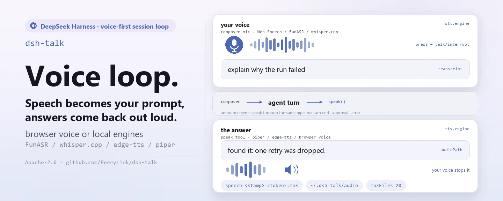

<div align="center">

<picture>
  <source media="(prefers-color-scheme: dark)" srcset="docs/assets/dsh-talk-hero-en-dark.webp">
  
</picture>

# dsh-talk

**Pulsa el micrófono y habla; la respuesta se lee en voz alta y, en cuanto empiezas a hablar, la reproducción se detiene.**

El bucle de sesión voice-first para DeepSeek Harness: la voz se convierte en texto del compositor, la herramienta `speak` lee las respuestas, los turnos completados, las aprobaciones pendientes y los errores se anuncian, y todos los motores pueden quedarse en tu propia máquina.

[Instalar](#instalación-en-tres-pasos) · [Configuración](#configuración) · [FAQ](#faq) · [简体中文](README.md) · [English](README.en.md) · [Español](README.es.md) · [Português](README.pt.md) · [हिन्दी](README.hi.md)

[](LICENSE)
[](#compatibilidad)
[](https://www.npmjs.com/package/dsh-talk)
[](https://github.com/PerryLink/dsh-talk/actions/workflows/ci.yml)
[](#compatibilidad)

[](https://github.com/PerryLink/dsh-talk/stargazers)
[](https://www.npmjs.com/package/dsh-talk)
[](https://dshfind.com/plugins/PerryLink/dsh-talk?ref=badge)
[](https://securityscorecards.dev/viewer/?uri=github.com/PerryLink/dsh-talk)
[](https://dsh.market/)
[](https://gitee.com/perrylink/dsh-talk)

```sh
dsh plugin --profile <name> add dsh-talk
```

</div>

<sub>Plugin de la comunidad, no afiliado a DeepSeek. Repositorio canónico: <https://github.com/PerryLink/dsh-talk> (Gitee es un espejo).</sub>

## Qué es

`dsh-talk` añade las dos mitades de la voz a DeepSeek Harness. En la entrada, el botón de micrófono junto al compositor graba, y Web Speech del navegador, un servidor HTTP FunASR o un `whisper.cpp` local convierten el audio en texto que rellena el borrador o lo envía. En la salida, el agente llama a la herramienta `speak` y la voz del navegador, `edge-tts` o `piper` convierten el texto en sonido. El fin de turno, las aprobaciones pendientes y los errores pueden anunciarse automáticamente, y en cuanto empiezas a hablar se detiene la reproducción actual: no hace falta ninguna cuenta en la nube y los motores locales pueden funcionar totalmente sin conexión.

<picture>
  <source media="(prefers-color-scheme: dark)" srcset="docs/assets/dsh-talk-flow-v5-dark.svg">
  
</picture>

*Estructura: una frontera navegador / host y dos canales opuestos — la voz de entrada cruza `talk/transcribe` hacia la escalera de motores del host (FunASR → whisper.cpp → Web Speech del navegador) y la transcripción vuelve como borrador; la bisagra `agent turn` la entrega a `speak()` y a los tres eventos de anuncio; la salida recorre la escalera TTS (piper → edge-tts → voz del navegador) hasta la caché y el directorio de exportación acotado, y vuelve a la reproducción por `talk/audio`; el raíl de interrupción cierra el bucle a la izquierda y la escritura de ajustes corre por debajo.*

## Instalación en tres pasos

1. **Instala** (elige un canal):

   ```sh
   # canal git (última main; equivale a git+https://github.com/PerryLink/dsh-talk.git)
   dsh plugin --profile web add github:PerryLink/dsh-talk
   # canal npm (versiones publicadas)
   dsh plugin --profile web add dsh-talk
   # canal tarball: pnpm pack en este repo y luego
   dsh plugin --profile web add ./dsh-talk-<version>.tgz
   ```

   El script `prepare` del canal git compila solo con dependencias de producción, así que no hace falta ninguna cadena de herramientas adicional.

2. **Configuración mínima** (los valores por defecto ya funcionan):

   De fábrica bastan los motores del navegador: el botón de micrófono transcribe con Web Speech y `speak` reproduce con SpeechSynthesis. Para usar motores locales, añade las rutas de los modelos con esta forma:

   ```yaml
   - insert:
       - id: talk
         name: dsh-talk
         config:
           stt:
             engine: whisper
             whisper:
               modelPath: ~/models/whisper/ggml-small.bin
           tts:
             engine: piper
             piper:
               modelPath: ~/models/piper/zh_CN-huayan-medium.onnx
   ```

3. **Comprueba que está activo**:

   ```sh
   dsh --profile web --dump-config | grep -A2 'id: talk'
   ```

   Después pulsa el micrófono junto al compositor y habla; o pide al agente que lea su respuesta:

   ```
   > Say "hello" with the speak tool.
   ```

**Desinstalar**: `dsh plugin --profile web remove dsh-talk` (o borra la fila del patch del perfil).

> Si pnpm informa de `ERR_PNPM_IGNORED_BUILDS` para este paquete (la validación inofensiva del binario de plataforma de esbuild), añade `allowBuilds: { esbuild: true }` a tu `pnpm-workspace.yaml`; la CLI de `dsh` imprime el fragmento exacto.

<details>
<summary>Instalar desde el mercado de DSH Desktop</summary>

Todos los plugins de PerryLink se pueden explorar en el mercado integrado en DSH Desktop: **Mercado → Fuentes → Añadir fuente → pegar** `https://perrylink-dsh-catalog.perrylink.workers.dev/catalog-source.json` **→ seleccionar**. La instalación sigue pasando por la verificación de identidad npm del mercado y por tu confirmación.

</details>

### Los navegadores remotos necesitan un origen seguro

El micrófono del navegador (`getUserMedia` / Web Speech / MediaRecorder) solo funciona en un
**contexto seguro**: `https://…` o `http://localhost` / `http://127.0.0.1`. Una página
`http://<LAN-IP>:3081` normal —incluido Safari en otra máquina— no expondrá el micrófono,
aunque los ajustes de Talk sean correctos.

Para un navegador remoto, usa una de estas opciones:

- abrir la UI web a través de un proxy inverso o túnel HTTPS;
- reenviar el puerto por SSH y abrir `http://localhost:<port>` en el cliente;
- mantener la UI en la misma máquina que el navegador.

`stt.engine: funasr` / `whisper` cambia *dónde se ejecuta la transcripción*, no el permiso
de captura del navegador; grabar sigue necesitando el contexto seguro.

## Capacidades clave

`dsh-talk` cierra el bucle de voz en ambas direcciones:

- **Herramienta `speak`** — el agente lee sus respuestas en voz alta. Motores TTS: la voz del navegador, `edge-tts` (voces neuronales por red) o `piper` (local). El audio suena en el navegador; con un motor local también se escribe en un archivo y el resultado de la herramienta lleva su ruta absoluta (`audioPath`) para que otras herramientas la consuman; en los hosts que pueden transportarlo, el registro de sesión anota el enunciado saneado (ver Límites de seguridad).
- **Botón de micrófono del compositor** — pulsar, hablar, y la transcripción cae en la caja de entrada (o se envía directamente). Motores STT: Web Speech del navegador (con resultados intermedios), un servidor HTTP FunASR o `whisper.cpp` local.
- **Hablar interrumpe** — empezar a hablar detiene lo que se esté reproduciendo (cliente → host por el espacio Remote `talk`).
- **Anuncios de eventos** — fin de turno, aprobaciones pendientes (seguro para waterfall: nunca bloquea la puerta) y errores, con interruptor de silencio y frases configurables.
- **Pestaña de ajustes** — selectores de motor/idioma e interruptores de anuncios, guardados como operaciones append-only del patch del perfil con copias de seguridad.

```text
browser                                host
  🎙 press ──▶ interrupt ─────────────────▶ talk/interrupt
  record (MediaRecorder / Web Speech)
  transcribe (browser) or talk/transcribe ─▶ FunASR / whisper.cpp
  setDraft(text) or submit()  ◀── talk:speech projection ── speak tool / announcements
  ▶ play audio (talk/audio or speechSynthesis)
```

### Herramientas y superficies

| Superficie | Tipo | Notas |
|---|---|---|
| `speak` | herramienta | Lee texto en voz alta (browser/edge-tts/piper); permite sobrescribir motor/voz por llamada; resultado JSON canónico |
| botón de micrófono | slot `conversation.input.left` | Grabar → transcribir → rellenar el borrador (o enviar); al pulsar, interrumpe la reproducción |
| pestaña de ajustes | `settings.plugins.tab` (id `talk`) | Interruptores de motor/idioma/anuncios; guardado append-only |
| `talk:*` | Typert Remote | `status`, `audio`, `transcribe`, `applySettings`, `interrupt` (espacio del host) |

### Ejemplos

Estas son las superficies reales; la pestaña de ajustes y el botón de micrófono son los puntos de entrada de la UI.

**Ejemplo detallado** — comando `speak`, entrada:

```json
{"text":"hello","engine":"browser"}
```

Salida:

```text
Spoke hello aloud with the browser engine. No audio file: the browser engine synthesizes in the browser.
```

*Observed from `plugins/dsh-talk/tests/lifecycle.spec.ts:124-137; renderer at src/tool.ts:47-64`*

**Rama de fallo** — entrada:

```text
{"text":"   "}
```

Salida:

```text
Error: dsh-talk: speak text must not be empty
```

*Observed from `plugins/dsh-talk/src/tool.ts:124; plugins/dsh-talk/tests/tool.spec.ts:41-44`*

**Ejemplos breves**: `talk:status` · `talk:transcribe`

## Configuración

Todos los ajustes son campos Schemastery `Config` (modificables desde cordis.yml). `cordis.patch.yml` documenta cada clave en línea.

Claves más usadas:

| Clave | Valor por defecto | Significado |
|---|---|---|
| `record.enabled` | `true` | Mostrar el botón de micrófono del compositor |
| `record.autoSubmit` | `false` | Enviar la transcripción como mensaje del usuario (false = rellenar el borrador) |
| `stt.engine` | `auto` | `auto` / `web` / `funasr` / `whisper`; auto prefiere un motor local configurado y luego Web Speech |
| `tts.engine` | `auto` | `auto` / `browser` / `edge-tts` / `piper`; auto prefiere piper, luego edge-tts y por último la voz del navegador |
| `tts.export.dir` | `<home>/.dsh-talk/audio` | Directorio de exportación; `~` = home, una ruta relativa se resuelve bajo home (nunca el workspace) |
| `announce.enabled` | `true` | Interruptor maestro de los anuncios de eventos |
| `interrupt` | `true` | Hablar detiene la reproducción actual |
| `maxSpeakChars` | `20000` | Límite de longitud del texto de la herramienta speak (1..100000) |

<details>
<summary>Tabla de configuración completa (28 claves)</summary>

| Clave | Valor por defecto | Significado |
|---|---|---|
| `record.enabled` | `true` | Mostrar el botón de micrófono del compositor |
| `record.hotkey` | *(ninguno)* | Atajo de alternancia opcional, p. ej. `"alt+r"` |
| `record.maxSeconds` | `60` | Límite de grabación en segundos (1..600) |
| `record.autoSubmit` | `false` | Enviar la transcripción como mensaje del usuario (false = rellenar el borrador) |
| `record.vad.enabled` / `silenceMs` / `energyThreshold` | `true` / `1500` / `0.01` | Detección de actividad de voz: el silencio termina la grabación automáticamente (se degrada si falta `AudioContext`) |
| `stt.engine` | `auto` | `auto` / `web` / `funasr` / `whisper`; auto prefiere un motor local configurado y luego Web Speech |
| `stt.language` | `auto` | Idioma BCP-47 o `auto` |
| `stt.interim` | `true` | Mostrar transcripciones intermedias (Web Speech) |
| `stt.silenceFinaliseMs` | `4000` | Detener el reconocimiento Web Speech continuo tras estos milisegundos sin habla (500..15000) |
| `stt.funasr.url` | *(ninguno)* | Endpoint de inferencia FunASR; obligatorio cuando el motor es `funasr` |
| `stt.whisper.modelPath` | *(ninguno)* | Modelo whisper.cpp; obligatorio cuando el motor es `whisper` |
| `tts.engine` | `auto` | `auto` / `browser` / `edge-tts` / `piper`; auto prefiere piper, luego edge-tts y por último la voz del navegador |
| `tts.rate` | `0` | Desplazamiento de velocidad en porcentaje (-50..50) para edge-tts/piper |
| `tts.fallbackToBrowser` | `true` | Volver a la voz del navegador si falla un motor local |
| `tts.browser.voiceName` | *(ninguno)* | Nombre de voz preferido del navegador; si no existe se usa la voz por defecto de la plataforma |
| `tts.browser.rate` | `1` | Velocidad de SpeechSynthesis del navegador (0.1..10) |
| `tts.browser.pitch` | `1` | Tono de SpeechSynthesis del navegador (0..2) |
| `tts.piper.modelPath` | *(ninguno)* | Modelo de voz piper; obligatorio cuando el motor es `piper` |
| `tts.export.enabled` | `true` | Escribir el audio sintetizado localmente en un archivo y devolver su ruta como `audioPath` |
| `tts.export.dir` | `<home>/.dsh-talk/audio` | Directorio de exportación; `~` = home, una ruta relativa se resuelve bajo home (nunca el workspace) |
| `tts.export.maxFiles` | `20` | Archivos conservados en el directorio de exportación, contando el recién escrito (1..1000) |
| `tts.export.maxAgeMinutes` | `1440` | Los archivos exportados con más minutos que esto se purgan en la siguiente escritura (1..10080) |
| `announce.enabled` | `true` | Interruptor maestro de los anuncios de eventos |
| `announce.onTurnEnd` / `onApproval` / `onError` | `true` | Qué eventos se anuncian |
| `announce.messages.*` | *"Turn complete." etc.* | Frases habladas |
| `interrupt` | `true` | Hablar detiene la reproducción actual |
| `maxSpeakChars` | `20000` | Límite de longitud del texto de la herramienta speak (1..100000) |
| `maxAudioCacheBytes` | `8388608` | Límite de la caché de audio sintetizado en memoria (1 MiB..64 MiB) |

</details>

`stt.silenceFinaliseMs` y `record.vad.silenceMs` son mecanismos separados: el primero finaliza la transcripción de Web Speech cuando el reconocimiento continuo no oye habla, el segundo es el detector por energía de MediaRecorder que termina la grabación (y la envía cuando `record.autoSubmit` está activo). Corren en canalizaciones distintas y no comparten estado.

### Exportación de archivos de audio

Cada enunciado sintetizado por un motor local (`edge-tts`, `piper`) se escribe en un archivo **además de** la caché en memoria desde la que reproduce el navegador. El motor del navegador sintetiza en el cliente y por tanto no exporta nada: ese estado se informa explícitamente, nunca en silencio.

- **Dónde**: `tts.export.dir`, por defecto `<home>/.dsh-talk/audio`, el directorio propio del plugin. Deliberadamente nunca es el directorio de trabajo del host, así que jamás contamina un repositorio; una ruta relativa de `tts.export.dir` se resuelve bajo el directorio home por la misma razón.
- **Nombres**: `speech-<YYYYMMDD>T<HHMMSS>Z-<8 hex>.mp3` (edge-tts) o `.wav` (piper). La marca es UTC, así que los nombres se ordenan cronológicamente, y el token viene del id del enunciado, de modo que un archivo se remonta a su entrada de registro `dsh-talk/speech`. El texto hablado nunca forma parte del nombre.
- **Limpieza**: acotada en cada escritura, primero por edad y luego por cantidad. Se eliminan los archivos más antiguos que `tts.export.maxAgeMinutes` (por defecto 1440 = 24 h) y después los más viejos hasta que el directorio contenga como máximo `tts.export.maxFiles` (por defecto 20, contando el recién escrito). La purga solo borra nombres que coinciden con el patrón `speech-…` del propio plugin, así que otros archivos de un directorio compartido nunca se tocan. Con los valores por defecto el directorio guarda como máximo 20 archivos (unos pocos MB) y nada de más de un día.
- **Fallo**: exportar es un añadido al habla, nunca una condición previa. Si el directorio no se puede crear o escribir, el enunciado se reproduce igualmente y el resultado informa `audioExport: "failed"` con el motivo; los fallos de purga se ignoran y se reintentan en la siguiente escritura.
- **Ruta visible para el modelo**: el valor canónico de la herramienta `speak` lleva `audioPath` (más `audioExport` y, cuando no hay archivo, `exportNote`), y la misma ruta está en el texto renderizado del resultado, así que el agente puede pasarla directamente a otra herramienta que acepte un archivo, por ejemplo el argumento de archivo de un plugin de mensajería. Los anuncios de eventos (fin de turno, aprobación, error) se sintetizan por la misma canalización y se exportan igual; están sujetos a los mismos límites.
- **Entregar el archivo a otro plugin**: un consumidor que solo acepta archivos dentro de su propio workspace —`send_wechat` de `dsh-wechat` rechaza un `file_path` fuera del workspace de la sesión llamante salvo que su propio ajuste `allowAnyFilePath` esté activo— rechazará una ruta bajo tu directorio home. Para ese flujo, apunta `tts.export.dir` a un directorio dentro de ese workspace (por ejemplo `<workspace>/.dsh-talk-audio`); el valor por defecto se queda fuera de todo repositorio a propósito.

Ejemplo de sobrescritura del patch del perfil:

```yaml
- insert:
    - id: talk
      name: dsh-talk
      config:
        tts:
          rate: 10
          fallbackToBrowser: false
        announce:
          onApproval: false
```

## FAQ

<details>
<summary>¿Dónde viven el audio y la transcripción? ¿Llega algo al registro de sesión?</summary>

Los bytes de audio solo entran en la caché en memoria (`maxAudioCacheBytes`, 8 MiB por defecto) y, con motores locales, en el directorio de exportación (`tts.export.*`, como máximo 20 archivos y 24 h por defecto); **nunca** en el contexto del modelo ni en el registro de sesión. El evento `dsh-talk/speech` se escribe solo donde el vocabulario del host lo acepta, y lleva únicamente el id del enunciado, el motor, el motivo, el tamaño, el texto saneado y los parámetros de voz del navegador cuando aplican. La única ruta de archivo persistente es `audioPath`: está pensada para entregarse a otra herramienta, así que sí aparece en el resultado de `speak`.

</details>

<details>
<summary>¿Qué pasa en hosts que no conocen `dsh-talk/speech`? ¿Falla en silencio?</summary>

No. En `0.1.1-rc.2`, la línea `0.1.2-alpha`, `0.1.2-rc.1` y `0.1.6-alpha.2` el vocabulario del host no conoce el evento, la puerta no escribe nada y la lista de reproducción de la sesión en el cliente queda vacía; pero el host mantiene contadores por sesión de añadidos/omitidos que `talk/latest(sessionId)` devuelve, y los resultados de la herramienta speak siguen siendo el rastro auditable reconstruible. El habla, el micrófono, la pestaña de ajustes y la herramienta no se ven afectados.

</details>

<details>
<summary>¿Competirá con otros plugins por nombres de herramientas, claves de servicio o slots?</summary>

No. Cada herramienta lleva espacio de nombres, solo aporta una clave de servicio (`talk`, que no es un seam integrado ni la proporciona ningún plugin de muchas estrellas estudiado), no registra ninguna clave de slot de cliente, no registra ningún prefijo `webServer` y no muta globales. El listener de `approval/request`, sensible al orden, siempre delega en `next()`, así que la cadena nunca se cortocircuita. El argumento completo está en «Interoperabilidad con otros plugins DSH».

</details>

<details>
<summary>¿Cuánto cuesta en rendimiento?</summary>

No hay llamadas extra al modelo. La transcripción ocurre en el navegador o en el motor que configures; el TTS local lanza un subproceso por enunciado, el audio va a una caché en memoria acotada y las escrituras de exportación usan la purga bidimensional (primero edad, luego cantidad). Los anuncios de eventos son fire-and-forget, y `approval/request` solo inicia un enunciado asíncrono: nunca bloquea la aprobación.

</details>

## Límites de seguridad

- **Visible para el modelo ⟺ registrado** — el modelo solo ve el valor canónico y el texto renderizado de la herramienta speak. El evento `dsh-talk/speech` se añade solo cuando el host puede transportarlo (ver Compatibilidad del host); los eventos `tool/call` + `tool/result` siguen siendo siempre el rastro reconstruible.
- **Los anuncios de aprobación nunca bloquean** — el listener de `approval/request` siempre llama a `next()`.
- **Salida saneada** — las credenciales y las rutas de audio temporales nunca llegan a registros ni pantallas. La única excepción deliberada es la ruta del audio exportado en el resultado de speak, que es un archivo persistente del directorio propio del plugin (aun así pasa por el redactor de secretos) y está pensada para entregarse a otra herramienta.
- **Compatibilidad del host** — el evento `dsh-talk/speech` se añade mediante una puerta sí/no. Los hosts cuyo vocabulario de tipos conocidos cubre el evento lo añaden, y la llamada informa que lo hizo; cualquier otro host —todas las líneas publicadas hasta `0.1.1-rc.2`, la línea `0.1.2-alpha`, `0.1.2-rc.1` y también `0.1.6-alpha.2`, cuyo `Session.append` solo puede estampar la intención de superficie y no el sobre `ignorable` (ese campo se conserva solo por compatibilidad de lectura de registros guardados)— no recibe ningún añadido, así que el habla nunca puede contaminar el registro de sesión allí. La omisión ya no es silenciosa: el host mantiene contadores por sesión de añadidos/omitidos, `talk/latest(sessionId)` los devuelve, la lista de reproducción de la sesión en el cliente queda vacía y los resultados de la herramienta speak siguen siendo el rastro auditable reconstruible.
- **Fallo ruidoso** — motores inválidos, valores fuera de rango y motores configurados sin su modelo/endpoint obligatorio fallan al montar.

## Permisos y datos

- **Permisos**: el plugin mantiene una caché de audio en memoria y acotada por bytes para la reproducción y, con motores locales, escribe el audio sintetizado en su propio directorio acotado (`tts.export.*`, por defecto `<home>/.dsh-talk/audio`, como máximo 20 archivos y 24 h por defecto); el permiso de micrófono lo gestiona el navegador. La pestaña de ajustes solo añade fragmentos de patch al perfil con una copia de seguridad con marca de tiempo: nunca reescribe el archivo.
- **Datos**: los bytes de audio nunca entran en el contexto del modelo ni en el registro de sesión. Donde el vocabulario de sesión del host lo acepta, el evento `dsh-talk/speech` lleva el id del enunciado, el motor, el motivo, el tamaño, el texto saneado y la voz/velocidad/tono del navegador cuando aplican; en hosts sin sobre el evento no se escribe en absoluto. El resultado de la herramienta `speak` lleva la ruta del archivo exportado (un artefacto persistente del directorio propio del plugin), y todo lo demás en una superficie de pantalla/registro pasa por los ayudantes de redacción, de modo que credenciales, JWT, cabeceras bearer y rutas temporales quedan fuera.
- **Red**: solo se contacta con los motores que configures. `edge-tts` realiza síntesis por red, FunASR usa su endpoint configurado y `webkitSpeechRecognition` de Chrome envía el audio del micrófono a los servidores de Google para transcribir; la reproducción con `speechSynthesis` del navegador sigue siendo local.

## Limitaciones conocidas

- **Soporte de navegador**: Web Speech y MediaRecorder se detectan por características; sin ellos el botón de micrófono se desactiva y los motores del host (FunASR/whisper.cpp) aún pueden transcribir si están configurados.
- **Los motores locales los instalas tú**: los ejecutables y modelos de `edge-tts`, `piper` y `whisper.cpp` deben instalarse por separado.
- **Los archivos de audio necesitan un motor local**: la voz del navegador sintetiza en el cliente, así que allí `speak` no devuelve `audioPath` (el resultado lo dice explícitamente), y un motor local que falla y cae al navegador tampoco tiene archivo. Los archivos exportados viven en el directorio acotado del propio plugin: consulta «Exportación de archivos de audio» para ubicación, nombres y limpieza.
- **Formato de grabación**: el navegador graba con su códec nativo de MediaRecorder; whisper.cpp puede requerir una grabadora configurada en WAV o una conversión en el servidor para otros formatos.
- **Los ajustes se aplican al recargar**: la pestaña de ajustes añade al patch del perfil; una recarga del perfil (o un reinicio de la web-app) activa los cambios.
- **El historial de reproducción en vivo está vacío en hosts sin el vocabulario**: en `0.1.1-rc.2`, la línea `0.1.2-alpha`, `0.1.2-rc.1` y `0.1.6-alpha.2` el vocabulario del host no conoce `dsh-talk/speech`, así que la puerta no escribe nada y la lista de reproducción de la sesión en el cliente queda vacía; `talk/latest(sessionId)` sigue respondiendo con el enunciado más reciente y el contador de omitidos. El habla, el micrófono, la pestaña de ajustes y la herramienta no se ven afectados.
- **Los registros antiguos escritos por dsh-talk ≤ 0.2.1 pueden necesitar reparación antes de la carga en frío**: las versiones hasta `0.2.1` añadían eventos `dsh-talk/speech` sin marcar. En hosts `0.1.0-rc.7` y posteriores, una sesión cuyo registro ya los contiene falla su siguiente carga en frío con `SessionFormatUnsupportedError`. Reparación: detén el host, haz copia de seguridad del registro `.jsonl` de la sesión, añade `"ignorable":true` como miembro de nivel superior de cada línea JSON cuyo `"type"` sea `"dsh-talk/speech"` (por ejemplo, inserta `"ignorable":true,` justo después de la `{` de apertura) y vuelve a abrir la sesión. Nada más cambia y no se pierde nada; los nuevos añadidos de esta versión nunca producen eventos sin marcar.

## Interoperabilidad con otros plugins DSH

Verificado contra **DSH `0.2.0-rc.2`** (el runtime para el que se publica este README) y el conjunto de plugins de muchas estrellas estudiado el 2026-10-05.

Este plugin **no interfiere** con otros plugins, incluidos los de muchas estrellas ampliamente instalados:

- **Sin colisión de nombres de herramienta.** Cada herramienta lleva espacio de nombres; no se registra ningún nombre desnudo propiedad de una herramienta integrada o de otro plugin.
- **Sin colisión de claves de servicio.** Solo aporta `talk`; esa clave no es un seam integrado ni la proporciona ningún plugin de muchas estrellas estudiado.
- **Sin colisión de slots.** No registra ninguna clave de slot de cliente, así que no puede competir por un asiento de `shadows-shipped-ui`.
- **Sin colisión de rutas HTTP.** No registra ningún prefijo `webServer`.
- **Sin colisión de capas de patch.** El patch del bundle solo `insert`a su propia fila; nunca sobrescribe el `config` de una fila integrada.
- **Sin mutación global.** No parchea prototipos, no reescribe `process.env` ni reemplaza el dispatcher global de fetch.

**Los listeners de eventos compartidos no interfieren por construcción.** Observa el evento sensible al orden `approval/request` con `ctx.on()`: el registro de difusión de Cordis, donde cada listener se ejecuta y ninguno puede matar de hambre a otro. **Aquí cada listener delega en `next()`**, así que la cadena nunca se cortocircuita, y una mutación se aplica al valor que produjo `next()` en lugar de devolverse en su lugar:

Evidencia estática: `dsh-plugin-doctor` K10–K13 informa `pass` en todas las comprobaciones de este repositorio.

## Compatibilidad

| Superficie | Estado |
|---|---|
| Harness | DeepSeek Harness `dsh-v0.2.1-alpha.1` (adaptado el 2026-09-24: tercera cláusula peer + `engines.dsh` + `manifestVersion: 1`, y el workflow Compat mensual anclado a esa línea); cadena completa de puertas en verde el 2026-09-24 (reglas duales de typecheck, 86 tests, build, self-contained, artifacts, pack). Línea npm de desarrollo/pruebas `0.1.7-rc.2`, peers `>=0.1.2-rc.1 <0.2.0 || >=0.1.5-alpha.1 <0.2.0 || >=0.1.6-0 <0.2.0 || >=0.1.7-0 <0.2.0`. |
| Node | `^22.19.0 \|\| >=24.9.0` |
| Navegador | Web Speech + MediaRecorder (mejor en Chrome/Edge); motores de transcripción/TTS del host para el resto |

## Ecosistema y calidad

- [Espejo en Gitee](https://gitee.com/perrylink/dsh-talk) (espejo sincronizado; GitHub es canónico)
- [Página del plugin en dshfind](https://dshfind.com/plugins/PerryLink/dsh-talk) (instalaciones y ranking)
- [Informe OpenSSF Scorecard](https://securityscorecards.dev/viewer/?uri=github.com/PerryLink/dsh-talk) (impulsado por [.github/workflows/scorecard.yml](.github/workflows/scorecard.yml))
- [Informe de verificación de dsh-plugin-doctor](https://github.com/PerryLink/dsh-plugin-doctor#verified-徽章) (K10–K13 todo `pass`)
- [DSH Market](https://dsh.market/) (listado)
- **Canal de la tienda 1024**: `npm i -g dsh1024` una vez y luego `dsh1024 plugin --profile web add dsh-talk` (cuenta para el ranking de instalaciones de [deepseek1024.com](https://deepseek1024.com))
- [Base de conocimiento del ecosistema](https://perrylink.github.io/dsh-plugin-guide/): guía de desarrollo de plugins · datos de selección · criterios de mantenimiento

## Desarrollo

```sh
pnpm install        # node ^22.19 || >=24.9
pnpm run typecheck  # tsc: src + tests contra el checkout local del harness
pnpm run typecheck:ci  # tsc contra los tipos publicados 0.1.7-alpha.2 (sin paths)
pnpm test           # vitest: 108 tests, 16 suites
pnpm run build      # declaraciones tsc + bundles tsdown (lib/)
pnpm run verify:self-contained  # las declaraciones de dependencias resuelven desde el registry
pnpm run verify:artifacts       # caras ESM construidas + handshake ModuleLoader del cliente
pnpm run check:readmes          # consistencia de los README en cinco idiomas
pnpm pack           # el tarball publicado
```

Las imágenes del README las genera [`scripts/gen-readme-assets.py`](scripts/gen-readme-assets.py) (Python + Pillow para el hero, SVG escrito a mano para el mapa de estructura): `docs/assets/dsh-talk-hero-{zh,en}-{light,dark}.webp` y `docs/assets/dsh-talk-flow-v5-{light,dark}.svg`, y se puede volver a ejecutar sin riesgo.

Topics: `dsh`, `dsh-plugin`, `deepseek-harness`, `deepseek`, `cordis`, `voice`, `speech`, `tts`, `stt`, `speech-to-text`, `text-to-speech`, `microphone`

## Familia y agradecimientos

Este proyecto forma parte de la familia de plugins de DeepSeek Harness de [PerryLink](https://github.com/PerryLink) (95 plugins, todos Apache-2.0). Si te resulta útil, **una estrella ayuda a que la siguiente persona lo encuentre**; no hay nada bloqueado tras ella.

- [@PerryLink](https://github.com/PerryLink) — creador y mantenedor: canalización de habla, motores de voz, grabador de micrófono, anuncios de eventos, unidad de proyección y la documentación en cinco idiomas.
- [@Mo-Mia](https://github.com/Mo-Mia) — privacidad/compatibilidad de Web Speech, acciones de entrada del compositor, fallback de idioma, dictado continuo, proyección `talk:speech` y propuestas de diseño de TTS del navegador (#2–#9); varias influyeron en la superficie de ajustes actual.

<details>
<summary>Expandir todos los plugins</summary>

| Plugin | Estado |
|---|---|
| **[dsh-aqua-input-check](https://github.com/PerryLink/dsh-aqua-input-check)** |  |
| **[dsh-archive-check](https://github.com/PerryLink/dsh-archive-check)** |  |
| **[dsh-auto-review](https://github.com/PerryLink/dsh-auto-review)** |  |
| **[dsh-autotier](https://github.com/PerryLink/dsh-autotier)** | 🧊 CONGELADO — ver el README del repo |
| **[dsh-bid-ca-precheck](https://github.com/PerryLink/dsh-bid-ca-precheck)** |  |
| **[dsh-bid-qual-check](https://github.com/PerryLink/dsh-bid-qual-check)** |  |
| **[dsh-cert-mcp](https://github.com/PerryLink/dsh-cert-mcp)** | 🧊 CONGELADO — ver el README del repo |
| **[dsh-checkpoint-rewind](https://github.com/PerryLink/dsh-checkpoint-rewind)** |  |
| **[dsh-click](https://github.com/PerryLink/dsh-click)** |  |
| **[dsh-composer-history](https://github.com/PerryLink/dsh-composer-history)** |  |
| **[dsh-contract-stance](https://github.com/PerryLink/dsh-contract-stance)** |  |
| **[dsh-customs-doc-check](https://github.com/PerryLink/dsh-customs-doc-check)** |  |
| **[dsh-data-quality](https://github.com/PerryLink/dsh-data-quality)** | 🧊 CONGELADO — ver el README del repo |
| **[dsh-demurrage-ledger](https://github.com/PerryLink/dsh-demurrage-ledger)** |  |
| **[dsh-doublecheck](https://github.com/PerryLink/dsh-doublecheck)** |  |
| **[dsh-drill-script-check](https://github.com/PerryLink/dsh-drill-script-check)** |  |
| **[dsh-eia-guide-check](https://github.com/PerryLink/dsh-eia-guide-check)** |  |
| **[dsh-emergency-plan](https://github.com/PerryLink/dsh-emergency-plan)** |  |
| **[dsh-essay-rubric-check](https://github.com/PerryLink/dsh-essay-rubric-check)** |  |
| **[dsh-evidence-check](https://github.com/PerryLink/dsh-evidence-check)** |  |
| **[dsh-export-ctl-check](https://github.com/PerryLink/dsh-export-ctl-check)** |  |
| **[dsh-fast](https://github.com/PerryLink/dsh-fast)** |  |
| **[dsh-fmea-table-check](https://github.com/PerryLink/dsh-fmea-table-check)** |  |
| **[dsh-forecast-penalty](https://github.com/PerryLink/dsh-forecast-penalty)** |  |
| **[dsh-fund-research](https://github.com/PerryLink/dsh-fund-research)** |  |
| **[dsh-github](https://github.com/PerryLink/dsh-github)** |  |
| **[dsh-gongwen-flow-check](https://github.com/PerryLink/dsh-gongwen-flow-check)** |  |
| **[dsh-gongwen-word-check](https://github.com/PerryLink/dsh-gongwen-word-check)** |  |
| **[dsh-guard-plan-qc](https://github.com/PerryLink/dsh-guard-plan-qc)** |  |
| **[dsh-hazchem-check](https://github.com/PerryLink/dsh-hazchem-check)** |  |
| **[dsh-hazplan-check](https://github.com/PerryLink/dsh-hazplan-check)** |  |
| **[dsh-hidden-risk-map](https://github.com/PerryLink/dsh-hidden-risk-map)** |  |
| **[dsh-hs-classify](https://github.com/PerryLink/dsh-hs-classify)** |  |
| **[dsh-icd-rule-check](https://github.com/PerryLink/dsh-icd-rule-check)** |  |
| **[dsh-industry-research](https://github.com/PerryLink/dsh-industry-research)** |  |
| **[dsh-lawcite-adapter](https://github.com/PerryLink/dsh-lawcite-adapter)** |  |
| **[dsh-laya](https://github.com/PerryLink/dsh-laya)** |  |
| **[dsh-lc-doc-check](https://github.com/PerryLink/dsh-lc-doc-check)** |  |
| **[dsh-learning-gap-check](https://github.com/PerryLink/dsh-learning-gap-check)** |  |
| **[dsh-library](https://github.com/PerryLink/dsh-library)** |  |
| **[dsh-local-ai](https://github.com/PerryLink/dsh-local-ai)** |  |
| **[dsh-lsp-actions](https://github.com/PerryLink/dsh-lsp-actions)** |  |
| **[dsh-mask](https://github.com/PerryLink/dsh-mask)** |  |
| **[dsh-mcp-panel](https://github.com/PerryLink/dsh-mcp-panel)** |  |
| **[dsh-medrec-qc](https://github.com/PerryLink/dsh-medrec-qc)** |  |
| **[dsh-memento](https://github.com/PerryLink/dsh-memento)** | 🧊 CONGELADO — ver el README del repo |
| **[dsh-nsfc-form-check](https://github.com/PerryLink/dsh-nsfc-form-check)** |  |
| **[dsh-nurse-record-check](https://github.com/PerryLink/dsh-nurse-record-check)** |  |
| **[dsh-observe](https://github.com/PerryLink/dsh-observe)** |  |
| **[dsh-origin-rvc-check](https://github.com/PerryLink/dsh-origin-rvc-check)** |  |
| **[dsh-ota-review-check](https://github.com/PerryLink/dsh-ota-review-check)** |  |
| **[dsh-output-styles](https://github.com/PerryLink/dsh-output-styles)** |  |
| **[dsh-paper-doc-adapter](https://github.com/PerryLink/dsh-paper-doc-adapter)** |  |
| **[dsh-permission-rules](https://github.com/PerryLink/dsh-permission-rules)** |  |
| **[dsh-permit-report-check](https://github.com/PerryLink/dsh-permit-report-check)** |  |
| **[dsh-pipeline-check](https://github.com/PerryLink/dsh-pipeline-check)** |  |
| **[dsh-pleading-draft](https://github.com/PerryLink/dsh-pleading-draft)** |  |
| **[dsh-plugin-doctor](https://github.com/PerryLink/dsh-plugin-doctor)** | 🚫 RETIRADO (repo archivado) |
| **[dsh-plugin-guide](https://github.com/PerryLink/dsh-plugin-guide)** |  |
| **[dsh-plugin-kit](https://github.com/PerryLink/dsh-plugin-kit)** | 🚫 RETIRADO (repo archivado) |
| **[dsh-plugin-upgrade](https://github.com/PerryLink/dsh-plugin-upgrade)** | 🚫 RETIRADO (repo archivado) |
| **[dsh-policy-brief-draft](https://github.com/PerryLink/dsh-policy-brief-draft)** |  |
| **[dsh-power-loss-split](https://github.com/PerryLink/dsh-power-loss-split)** |  |
| **[dsh-power-ticket-check](https://github.com/PerryLink/dsh-power-ticket-check)** |  |
| **[dsh-ppap-check](https://github.com/PerryLink/dsh-ppap-check)** |  |
| **[dsh-protest-deadline](https://github.com/PerryLink/dsh-protest-deadline)** |  |
| **[dsh-railway-window](https://github.com/PerryLink/dsh-railway-window)** |  |
| **[dsh-repair-order-qc](https://github.com/PerryLink/dsh-repair-order-qc)** |  |
| **[dsh-research-report](https://github.com/PerryLink/dsh-research-report)** |  |
| **[dsh-review-reply-check](https://github.com/PerryLink/dsh-review-reply-check)** |  |
| **[dsh-rulefile-check](https://github.com/PerryLink/dsh-rulefile-check)** |  |
| **[dsh-safety-brief-check](https://github.com/PerryLink/dsh-safety-brief-check)** |  |
| **[dsh-score](https://github.com/PerryLink/dsh-score)** | 🧊 CONGELADO — ver el README del repo |
| **[dsh-session-sync](https://github.com/PerryLink/dsh-session-sync)** |  |
| **[dsh-site-log-check](https://github.com/PerryLink/dsh-site-log-check)** |  |
| **[dsh-skill-pack-security](https://github.com/PerryLink/dsh-skill-pack-security)** |  |
| **[dsh-soe-decision-check](https://github.com/PerryLink/dsh-soe-decision-check)** |  |
| **[dsh-soilwater-check](https://github.com/PerryLink/dsh-soilwater-check)** |  |
| **[dsh-sop-sync-check](https://github.com/PerryLink/dsh-sop-sync-check)** |  |
| **[dsh-spc-gbt-adapter](https://github.com/PerryLink/dsh-spc-gbt-adapter)** |  |
| **[dsh-talk](https://github.com/PerryLink/dsh-talk)** |  |
| **[dsh-tender-extract](https://github.com/PerryLink/dsh-tender-extract)** |  |
| **[dsh-tender-matrix](https://github.com/PerryLink/dsh-tender-matrix)** |  |
| **[dsh-test-drive](https://github.com/PerryLink/dsh-test-drive)** |  |
| **[dsh-ticktick](https://github.com/PerryLink/dsh-ticktick)** | 🚫 RETIRADO (repo archivado) |
| **[dsh-translate](https://github.com/PerryLink/dsh-translate)** |  |
| **[dsh-warranty-calc](https://github.com/PerryLink/dsh-warranty-calc)** |  |
| **[dsh-budget](https://github.com/PerryLink/dsh-budget)** | 🧊 CONGELADO — ver el README del repo |
| **[dsh-claude-move](https://github.com/PerryLink/dsh-claude-move)** | 🧊 CONGELADO — ver el README del repo |
| **[dsh-defend](https://github.com/PerryLink/dsh-defend)** | 🧊 CONGELADO — ver el README del repo |
| **[dsh-draw](https://github.com/PerryLink/dsh-draw)** | 🧊 CONGELADO — ver el README del repo |
| **[dsh-reach](https://github.com/PerryLink/dsh-reach)** | 🧊 CONGELADO — ver el README del repo |
| **[dsh-background-agents](https://github.com/PerryLink/dsh-background-agents)** | 🚫 RETIRADO (repo archivado) |
| **[dsh-session-pin](https://github.com/PerryLink/dsh-session-pin)** | 🚫 RETIRADO (repo archivado) |
| **[dsh-team-rooms](https://github.com/PerryLink/dsh-team-rooms)** | 🚫 RETIRADO (repo archivado) |

</details>

## Licencia

[LICENSE](LICENSE) (Apache License 2.0) © 2026 dsh-talk contributors

<p align="center"><sub>Apache-2.0 · Plugin de la comunidad, no afiliado a DeepSeek.</sub></p>
