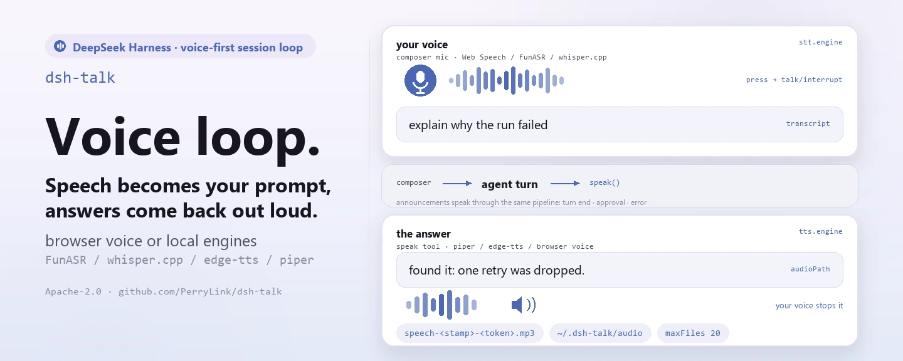

<div align="center">

<picture>
  <source media="(prefers-color-scheme: dark)" srcset="docs/assets/dsh-talk-hero-en-dark.webp">
  
</picture>

# dsh-talk

**माइक दबाइए और बोलिए; जवाब बोलकर सुनाया जाता है — और जैसे ही आप बोलना शुरू करते हैं, प्लेबैक रुक जाता है।**

DeepSeek Harness के लिए voice-first सेशन लूप: बोली कंपोज़र टेक्स्ट बनती है, `speak` टूल जवाब पढ़कर सुनाता है, टर्न पूरा होना / लंबित अनुमोदन / त्रुटियाँ बोलकर बताई जाती हैं, और सभी इंजन आपकी अपनी मशीन पर ही रह सकते हैं।

[इंस्टॉल](#तीन-चरणों-में-शुरुआत) · [कॉन्फ़िगरेशन](#कॉन्फ़िगरेशन) · [FAQ](#faq) · [简体中文](README.md) · [English](README.en.md) · [Español](README.es.md) · [Português](README.pt.md) · [हिन्दी](README.hi.md)

[](LICENSE)
[](#संगतता)
[](https://www.npmjs.com/package/dsh-talk)
[](https://github.com/PerryLink/dsh-talk/actions/workflows/ci.yml)
[](#संगतता)

[](https://github.com/PerryLink/dsh-talk/stargazers)
[](https://www.npmjs.com/package/dsh-talk)
[](https://dshfind.com/plugins/PerryLink/dsh-talk?ref=badge)
[](https://securityscorecards.dev/viewer/?uri=github.com/PerryLink/dsh-talk)
[](https://dsh.market/)
[](https://gitee.com/perrylink/dsh-talk)

```sh
dsh plugin --profile <name> add dsh-talk
```

</div>

<sub>सामुदायिक प्लगइन, DeepSeek से असंबद्ध। कैनोनिकल रिपॉज़िटरी: <https://github.com/PerryLink/dsh-talk> (Gitee एक मिरर है)।</sub>

## यह क्या है

`dsh-talk` DeepSeek Harness में आवाज़ के दोनों सिरे जोड़ता है। इनपुट की ओर, कंपोज़र के पास का माइक बटन रिकॉर्ड करता है, और ब्राउज़र का Web Speech, कोई FunASR HTTP सर्वर या लोकल `whisper.cpp` उस ऑडियो को टेक्स्ट बनाता है जो ड्राफ़्ट भरता है या सीधे सबमिट करता है। आउटपुट की ओर, एजेंट `speak` टूल कॉल करता है और ब्राउज़र वॉइस, `edge-tts` या `piper` टेक्स्ट को आवाज़ बनाते हैं। टर्न पूरा होना, लंबित अनुमोदन और त्रुटियाँ अपने आप बोलकर बताई जा सकती हैं, और जैसे ही आप बोलना शुरू करते हैं चालू प्लेबैक रुक जाता है — किसी क्लाउड खाते की ज़रूरत नहीं, और लोकल इंजन पूरी तरह ऑफ़लाइन चल सकते हैं।

<picture>
  <source media="(prefers-color-scheme: dark)" srcset="docs/assets/dsh-talk-flow-v5-dark.svg">
  
</picture>

*संरचना: एक ब्राउज़र / होस्ट सीमा और दो विपरीत चैनल — बोली जाने वाली आवाज़ `talk/transcribe` से होस्ट इंजन सीढ़ी (FunASR → whisper.cpp → ब्राउज़र Web Speech) में जाती है और ट्रांसक्रिप्ट ड्राफ़्ट के रूप में लौटती है; बीच का `agent turn` हिंज उसे `speak()` और तीन घटना-घोषणाओं तक पहुँचाता है; आउटपुट TTS सीढ़ी (piper → edge-tts → ब्राउज़र वॉइस) से कैश और सीमित एक्सपोर्ट निर्देशिका तक जाता है, फिर `talk/audio` से प्लेबैक पर लौटता है; बाएँ किनारे का interrupt रेल लूप बंद करता है और नीचे सेटिंग्स राइट-बैक चलता है।*

## तीन चरणों में शुरुआत

1. **इंस्टॉल करें** (कोई एक चैनल चुनें):

   ```sh
   # git चैनल (नवीनतम main; git+https://github.com/PerryLink/dsh-talk.git के बराबर)
   dsh plugin --profile web add github:PerryLink/dsh-talk
   # npm चैनल (प्रकाशित रिलीज़)
   dsh plugin --profile web add dsh-talk
   # tarball चैनल: इस रेपो में pnpm pack, फिर
   dsh plugin --profile web add ./dsh-talk-<version>.tgz
   ```

   git चैनल का `prepare` स्क्रिप्ट केवल प्रोडक्शन निर्भरताओं से बिल्ड करता है, इसलिए अलग टूलचेन की ज़रूरत नहीं।

2. **न्यूनतम कॉन्फ़िगरेशन** (डिफ़ॉल्ट पहले से काम करते हैं):

   बिना किसी सेटअप के ब्राउज़र इंजन चल जाते हैं: माइक बटन Web Speech से ट्रांसक्राइब करता है और `speak` SpeechSynthesis से बजाता है। लोकल इंजन इस्तेमाल करने के लिए मॉडल पथ इस आकार में जोड़ें:

   ```yaml
   - insert:
       - id: talk
         name: dsh-talk
         config:
           stt:
             engine: whisper
             whisper:
               modelPath: ~/models/whisper/ggml-small.bin
           tts:
             engine: piper
             piper:
               modelPath: ~/models/piper/zh_CN-huayan-medium.onnx
   ```

3. **जाँचें कि चालू है**:

   ```sh
   dsh --profile web --dump-config | grep -A2 'id: talk'
   ```

   फिर कंपोज़र के पास का माइक दबाकर बोलिए; या एजेंट से अपना जवाब पढ़ने को कहिए:

   ```
   > Say "hello" with the speak tool.
   ```

**अनइंस्टॉल**: `dsh plugin --profile web remove dsh-talk` (या प्रोफ़ाइल पैच से वह पंक्ति हटा दें)।

> अगर pnpm इस पैकेज के लिए `ERR_PNPM_IGNORED_BUILDS` बताता है (esbuild का हानिरहित प्लेटफ़ॉर्म-बाइनरी सत्यापन), तो अपने `pnpm-workspace.yaml` में `allowBuilds: { esbuild: true }` जोड़ें — `dsh` CLI ठीक वही स्निपेट छापता है।

<details>
<summary>DSH Desktop मार्केट से इंस्टॉल करें</summary>

सभी PerryLink प्लगइन DSH Desktop के अंतर्निहित मार्केट में देखे जा सकते हैं: **मार्केट → स्रोत → स्रोत जोड़ें → चिपकाएँ** `https://perrylink-dsh-catalog.perrylink.workers.dev/catalog-source.json` **→ चुनें**। इंस्टॉल अब भी मार्केट के npm पहचान सत्यापन और आपकी पुष्टि से होता है।

</details>

### रिमोट ब्राउज़र को सुरक्षित ओरिजिन चाहिए

ब्राउज़र माइक (`getUserMedia` / Web Speech / MediaRecorder) केवल **सुरक्षित संदर्भ** में चलता है:
`https://…` या `http://localhost` / `http://127.0.0.1`। सादा
`http://<LAN-IP>:3081` पेज — दूसरी मशीन के Safari सहित — माइक उजागर नहीं करेगा,
चाहे Talk सेटिंग सही हो।

रिमोट ब्राउज़र के लिए इनमें से एक इस्तेमाल करें:

- Web UI को HTTPS रिवर्स प्रॉक्सी या टनल से खोलें;
- SSH से पोर्ट फ़ॉरवर्ड करें और क्लाइंट पर `http://localhost:<port>` खोलें;
- UI को ब्राउज़र वाली ही मशीन पर रखें।

`stt.engine: funasr` / `whisper` यह बदलता है कि *ट्रांसक्रिप्शन कहाँ चलता है*, ब्राउज़र की
कैप्चर अनुमति नहीं; रिकॉर्डिंग के लिए सुरक्षित संदर्भ फिर भी चाहिए।

## मुख्य क्षमताएँ

`dsh-talk` दोनों दिशाओं में वॉइस लूप बंद करता है:

- **`speak` टूल** — एजेंट अपने जवाब बोलकर सुनाता है। TTS इंजन: ब्राउज़र वॉइस, `edge-tts` (नेटवर्क न्यूरल वॉइस) या `piper` (लोकल)। ऑडियो ब्राउज़र में बजता है; लोकल इंजन के साथ यह फ़ाइल में भी लिखा जाता है और टूल परिणाम उसका पूर्ण पथ (`audioPath`) लेकर चलता है ताकि दूसरे टूल उसे इस्तेमाल कर सकें; जो होस्ट इसे ले जा सकते हैं वहाँ सेशन लॉग सैनिटाइज़ किया हुआ उच्चारण दर्ज करता है (सुरक्षा सीमाएँ देखें)।
- **कंपोज़र माइक बटन** — दबाइए, बोलिए, और ट्रांसक्रिप्शन इनपुट बॉक्स में आ जाता है (या सीधे सबमिट हो जाता है)। STT इंजन: ब्राउज़र का Web Speech (मध्यवर्ती परिणामों सहित), FunASR HTTP सर्वर या लोकल `whisper.cpp`।
- **बोलना शुरू = रोकना** — बोलना शुरू करते ही जो बज रहा है वह रुक जाता है (क्लाइंट → होस्ट, `talk` Remote नेमस्पेस से)।
- **इवेंट घोषणाएँ** — टर्न पूरा होना, लंबित अनुमोदन (waterfall-सुरक्षित: गेट कभी नहीं रोकता) और त्रुटियाँ, म्यूट स्विच और बदली जा सकने वाली बोलियों के साथ।
- **सेटिंग्स टैब** — इंजन/भाषा चयन और घोषणा स्विच, बैकअप के साथ append-only प्रोफ़ाइल-पैच ऑपरेशन के रूप में सहेजे जाते हैं।

```text
browser                                host
  🎙 press ──▶ interrupt ─────────────────▶ talk/interrupt
  record (MediaRecorder / Web Speech)
  transcribe (browser) or talk/transcribe ─▶ FunASR / whisper.cpp
  setDraft(text) or submit()  ◀── talk:speech projection ── speak tool / announcements
  ▶ play audio (talk/audio or speechSynthesis)
```

### टूल और सतहें

| सतह | प्रकार | टिप्पणी |
|---|---|---|
| `speak` | टूल | टेक्स्ट बोलकर सुनाता है (browser/edge-tts/piper); प्रति कॉल इंजन/वॉइस ओवरराइड; कैनोनिकल JSON परिणाम |
| माइक बटन | `conversation.input.left` स्लॉट | रिकॉर्ड → ट्रांसक्राइब → ड्राफ़्ट भरें (या सबमिट); दबाने पर प्लेबैक रुकता है |
| सेटिंग्स टैब | `settings.plugins.tab` (id `talk`) | इंजन/भाषा/घोषणा स्विच; append-only सेव |
| `talk:*` | Typert Remote | `status`, `audio`, `transcribe`, `applySettings`, `interrupt` (होस्ट नेमस्पेस) |

### उदाहरण

ये वास्तविक सतहें हैं; सेटिंग्स टैब और माइक बटन UI प्रवेश बिंदु हैं।

**विस्तृत उदाहरण** — कमांड `speak`, इनपुट:

```json
{"text":"hello","engine":"browser"}
```

आउटपुट:

```text
Spoke hello aloud with the browser engine. No audio file: the browser engine synthesizes in the browser.
```

*Observed from `plugins/dsh-talk/tests/lifecycle.spec.ts:124-137; renderer at src/tool.ts:47-64`*

**विफलता शाखा** — इनपुट:

```text
{"text":"   "}
```

आउटपुट:

```text
Error: dsh-talk: speak text must not be empty
```

*Observed from `plugins/dsh-talk/src/tool.ts:124; plugins/dsh-talk/tests/tool.spec.ts:41-44`*

**संक्षिप्त उदाहरण**: `talk:status` · `talk:transcribe`

## कॉन्फ़िगरेशन

सभी समायोज्य विकल्प Schemastery `Config` फ़ील्ड हैं (cordis.yml से बदले जा सकते हैं)। `cordis.patch.yml` हर कुंजी को इनलाइन समझाता है।

सबसे ज़्यादा इस्तेमाल होने वाली कुंजियाँ:

| कुंजी | डिफ़ॉल्ट | अर्थ |
|---|---|---|
| `record.enabled` | `true` | कंपोज़र माइक बटन दिखाएँ |
| `record.autoSubmit` | `false` | ट्रांसक्रिप्शन को उपयोगकर्ता संदेश के रूप में सबमिट करें (false = ड्राफ़्ट भरें) |
| `stt.engine` | `auto` | `auto` / `web` / `funasr` / `whisper`; auto पहले कॉन्फ़िगर किया लोकल इंजन, फिर Web Speech चुनता है |
| `tts.engine` | `auto` | `auto` / `browser` / `edge-tts` / `piper`; auto पहले piper, फिर edge-tts, अंत में ब्राउज़र वॉइस चुनता है |
| `tts.export.dir` | `<home>/.dsh-talk/audio` | निर्यात निर्देशिका; `~` = home, सापेक्ष पथ home के अंतर्गत हल होता है (कभी workspace में नहीं) |
| `announce.enabled` | `true` | इवेंट घोषणाओं का मुख्य स्विच |
| `interrupt` | `true` | बोलना शुरू करने पर चालू प्लेबैक रुकता है |
| `maxSpeakChars` | `20000` | speak टूल के टेक्स्ट की सीमा (1..100000) |

<details>
<summary>पूरी कॉन्फ़िगरेशन तालिका (28 कुंजियाँ)</summary>

| कुंजी | डिफ़ॉल्ट | अर्थ |
|---|---|---|
| `record.enabled` | `true` | कंपोज़र माइक बटन दिखाएँ |
| `record.hotkey` | *(कोई नहीं)* | वैकल्पिक टॉगल शॉर्टकट, जैसे `"alt+r"` |
| `record.maxSeconds` | `60` | रिकॉर्डिंग सीमा सेकंड में (1..600) |
| `record.autoSubmit` | `false` | ट्रांसक्रिप्शन को उपयोगकर्ता संदेश के रूप में सबमिट करें (false = ड्राफ़्ट भरें) |
| `record.vad.enabled` / `silenceMs` / `energyThreshold` | `true` / `1500` / `0.01` | वॉइस एक्टिविटी डिटेक्शन: चुप्पी रिकॉर्डिंग अपने आप समाप्त करती है (`AudioContext` न होने पर यह घटिया तरीके से काम करता है) |
| `stt.engine` | `auto` | `auto` / `web` / `funasr` / `whisper`; auto पहले कॉन्फ़िगर किया लोकल इंजन, फिर Web Speech चुनता है |
| `stt.language` | `auto` | BCP-47 भाषा या `auto` |
| `stt.interim` | `true` | मध्यवर्ती ट्रांसक्रिप्शन दिखाएँ (Web Speech) |
| `stt.silenceFinaliseMs` | `4000` | इतने मिलीसेकंड बिना बोली के बाद लगातार Web Speech पहचान रोकें (500..15000) |
| `stt.funasr.url` | *(कोई नहीं)* | FunASR इन्फ़रेंस एंडपॉइंट; इंजन `funasr` होने पर अनिवार्य |
| `stt.whisper.modelPath` | *(कोई नहीं)* | whisper.cpp मॉडल; इंजन `whisper` होने पर अनिवार्य |
| `tts.engine` | `auto` | `auto` / `browser` / `edge-tts` / `piper`; auto पहले piper, फिर edge-tts, अंत में ब्राउज़र वॉइस चुनता है |
| `tts.rate` | `0` | edge-tts/piper के लिए गति बदलाव प्रतिशत में (-50..50) |
| `tts.fallbackToBrowser` | `true` | लोकल इंजन विफल होने पर ब्राउज़र वॉइस पर लौटें |
| `tts.browser.voiceName` | *(कोई नहीं)* | पसंदीदा ब्राउज़र वॉइस नाम; अनजान नाम पर प्लेटफ़ॉर्म डिफ़ॉल्ट चलता है |
| `tts.browser.rate` | `1` | ब्राउज़र SpeechSynthesis गति (0.1..10) |
| `tts.browser.pitch` | `1` | ब्राउज़र SpeechSynthesis पिच (0..2) |
| `tts.piper.modelPath` | *(कोई नहीं)* | piper वॉइस मॉडल; इंजन `piper` होने पर अनिवार्य |
| `tts.export.enabled` | `true` | लोकल से सिंथेसाइज़ किया ऑडियो फ़ाइल में लिखें और उसका पथ `audioPath` के रूप में लौटाएँ |
| `tts.export.dir` | `<home>/.dsh-talk/audio` | निर्यात निर्देशिका; `~` = home, सापेक्ष पथ home के अंतर्गत हल होता है (कभी workspace में नहीं) |
| `tts.export.maxFiles` | `20` | निर्यात निर्देशिका में रखी फ़ाइलें, अभी लिखी गई सहित (1..1000) |
| `tts.export.maxAgeMinutes` | `1440` | इतने मिनट से पुरानी निर्यात फ़ाइलें अगली लिखावट पर साफ़ होती हैं (1..10080) |
| `announce.enabled` | `true` | इवेंट घोषणाओं का मुख्य स्विच |
| `announce.onTurnEnd` / `onApproval` / `onError` | `true` | कौन-से इवेंट बोले जाएँ |
| `announce.messages.*` | *"Turn complete." आदि* | बोली जाने वाली पंक्तियाँ |
| `interrupt` | `true` | बोलना शुरू करने पर चालू प्लेबैक रुकता है |
| `maxSpeakChars` | `20000` | speak टूल के टेक्स्ट की सीमा (1..100000) |
| `maxAudioCacheBytes` | `8388608` | मेमोरी में सिंथेसाइज़ ऑडियो कैश की सीमा (1 MiB..64 MiB) |

</details>

`stt.silenceFinaliseMs` और `record.vad.silenceMs` अलग-अलग तंत्र हैं: पहला तब Web Speech ट्रांसक्रिप्ट अंतिम करता है जब लगातार पहचान को बोली नहीं सुनाई देती, दूसरा MediaRecorder का ऊर्जा-आधारित डिटेक्टर है जो रिकॉर्डिंग समाप्त करता है (और `record.autoSubmit` चालू होने पर उसे सबमिट करता है)। दोनों अलग पाइपलाइन में चलते हैं और कोई स्थिति साझा नहीं करते।

### ऑडियो फ़ाइल निर्यात

लोकल इंजन (`edge-tts`, `piper`) से सिंथेसाइज़ होने वाला हर उच्चारण ब्राउज़र के प्लेबैक वाले इन-मेमोरी कैश के **अतिरिक्त** एक फ़ाइल में भी लिखा जाता है। ब्राउज़र इंजन क्लाइंट पर सिंथेसाइज़ करता है और इसलिए कुछ भी निर्यात नहीं करता — यह स्थिति स्पष्ट रूप से बताई जाती है, कभी चुपचाप नहीं।

- **कहाँ**: `tts.export.dir`, डिफ़ॉल्ट `<home>/.dsh-talk/audio` — प्लगइन की अपनी निर्देशिका। यह जानबूझकर होस्ट की कार्यशील निर्देशिका कभी नहीं होती, इसलिए कोई रेपो कभी गंदा नहीं होता; सापेक्ष `tts.export.dir` भी इसी कारण home निर्देशिका के अंतर्गत हल होता है।
- **नाम**: `speech-<YYYYMMDD>T<HHMMSS>Z-<8 hex>.mp3` (edge-tts) या `.wav` (piper)। टाइमस्टैम्प UTC है इसलिए नाम कालक्रम में क्रमबद्ध होते हैं, और टोकन उच्चारण id से आता है, इसलिए फ़ाइल अपनी `dsh-talk/speech` लॉग प्रविष्टि तक वापस जुड़ती है। बोला गया टेक्स्ट कभी फ़ाइल नाम का हिस्सा नहीं होता।
- **सफ़ाई**: हर लिखावट पर सीमित, पहले आयु से फिर संख्या से। `tts.export.maxAgeMinutes` (डिफ़ॉल्ट 1440 = 24 घंटे) से पुरानी फ़ाइलें हटती हैं, फिर सबसे पुरानी फ़ाइलें तब तक हटती हैं जब तक निर्देशिका में `tts.export.maxFiles` (डिफ़ॉल्ट 20, अभी लिखी फ़ाइल सहित) से ज़्यादा न रहें। सफ़ाई केवल इस प्लगइन के अपने `speech-…` पैटर्न से मेल खाते नाम हटाती है, इसलिए साझा निर्देशिका की दूसरी फ़ाइलें कभी नहीं छूतीं। डिफ़ॉल्ट पर निर्देशिका में अधिकतम 20 फ़ाइलें (कुछ MB) और एक दिन से पुराना कुछ नहीं रहता।
- **विफलता**: निर्यात बोली का अतिरिक्त हिस्सा है, कभी पूर्व-शर्त नहीं। निर्देशिका बन न पाए या लिखी न जा सके तो उच्चारण फिर भी बजता है और परिणाम कारण के साथ `audioExport: "failed"` बताता है; सफ़ाई की विफलताएँ अनदेखी होती हैं और अगली लिखावट पर फिर कोशिश होती है।
- **मॉडल को दिखने वाला पथ**: `speak` टूल का कैनोनिकल मान `audioPath` लेकर चलता है (साथ में `audioExport` और, फ़ाइल न होने पर, `exportNote`), और वही पथ रेंडर किए गए परिणाम टेक्स्ट में भी है — इसलिए एजेंट इसे सीधे किसी ऐसे टूल को दे सकता है जो फ़ाइल लेता है, जैसे किसी मैसेंजर प्लगइन का फ़ाइल आर्ग्युमेंट। इवेंट घोषणाएँ (टर्न समाप्ति, अनुमोदन, त्रुटि) उसी पाइपलाइन से सिंथेसाइज़ होती हैं और उसी तरह निर्यात होती हैं; उन पर वही सीमाएँ लागू हैं।
- **फ़ाइल दूसरे प्लगइन को देना**: ऐसा उपभोक्ता जो केवल अपने workspace के अंदर की फ़ाइलें स्वीकार करता है — `dsh-wechat` का `send_wechat`, जब तक उसका अपना `allowAnyFilePath` सेटिंग चालू न हो, कॉल करने वाले सेशन के workspace के बाहर का `file_path` अस्वीकार करता है — आपकी home निर्देशिका के पथ को अस्वीकार करेगा। उस फ़्लो के लिए `tts.export.dir` को उसी workspace के अंदर की निर्देशिका पर सेट करें (जैसे `<workspace>/.dsh-talk-audio`); डिफ़ॉल्ट जानबूझकर हर रेपो से बाहर रहता है।

प्रोफ़ाइल पैच ओवरराइड उदाहरण:

```yaml
- insert:
    - id: talk
      name: dsh-talk
      config:
        tts:
          rate: 10
          fallbackToBrowser: false
        announce:
          onApproval: false
```

## FAQ

<details>
<summary>ऑडियो और ट्रांसक्रिप्ट कहाँ रहते हैं? क्या कुछ सेशन लॉग में जाता है?</summary>

ऑडियो बाइट्स केवल इन-मेमोरी कैश (`maxAudioCacheBytes`, डिफ़ॉल्ट 8 MiB) में और, लोकल इंजन के साथ, निर्यात निर्देशिका (`tts.export.*`, डिफ़ॉल्ट रूप से अधिकतम 20 फ़ाइलें और 24 घंटे) में जाते हैं — **कभी** मॉडल संदर्भ या सेशन लॉग में नहीं। `dsh-talk/speech` इवेंट केवल वहाँ लिखा जाता है जहाँ होस्ट की शब्दावली उसे स्वीकार करती है, और उसमें केवल उच्चारण id, इंजन, कारण, आकार, सैनिटाइज़ किया टेक्स्ट और लागू होने पर ब्राउज़र वॉइस पैरामीटर होते हैं। एकमात्र स्थायी फ़ाइल पथ `audioPath` है — वह दूसरे टूल को देने के लिए ही है, इसलिए हाँ, वह `speak` के परिणाम में दिखता है।

</details>

<details>
<summary>जो होस्ट `dsh-talk/speech` नहीं जानते वहाँ क्या होता है? क्या चुपचाप विफल होता है?</summary>

नहीं। `0.1.1-rc.2`, `0.1.2-alpha` लाइन, `0.1.2-rc.1` और `0.1.6-alpha.2` पर होस्ट की शब्दावली उस इवेंट को नहीं जानती, गेट कुछ नहीं लिखता और क्लाइंट की सेशन-स्कोप्ड प्लेलिस्ट खाली रहती है; लेकिन होस्ट प्रति सेशन जोड़े गए/छोड़े गए काउंटर रखता है जिन्हें `talk/latest(sessionId)` वापस पढ़ता है, और speak टूल के परिणाम फिर भी पुनर्निर्माण योग्य ऑडिट ट्रेल रहते हैं। बोली, माइक, सेटिंग्स टैब और टूल स्वयं प्रभावित नहीं होते।

</details>

<details>
<summary>क्या यह दूसरे प्लगइन से टूल नाम, सर्विस कुंजी या स्लॉट के लिए टकराएगा?</summary>

नहीं। हर टूल नेमस्पेस वाला है, यह ठीक एक सर्विस कुंजी (`talk`) देता है (जो निर्मित seam नहीं है और किसी सर्वेक्षित हाई-स्टार प्लगइन ने नहीं दी है), कोई क्लाइंट स्लॉट कुंजी पंजीकृत नहीं करता, कोई `webServer` प्रीफ़िक्स पंजीकृत नहीं करता और कोई ग्लोबल नहीं बदलता। क्रम-संवेदी `approval/request` लिसनर हमेशा `next()` से डेलिगेट करता है, इसलिए श्रृंखला कभी शॉर्ट-सर्किट नहीं होती। पूरा तर्क «अन्य DSH प्लगइनों के साथ इंटरऑपरेबिलिटी» में है।

</details>

<details>
<summary>प्रदर्शन लागत कितनी है?</summary>

कोई अतिरिक्त मॉडल कॉल नहीं। ट्रांसक्रिप्शन ब्राउज़र में या आपके कॉन्फ़िगर किए इंजन में होता है; लोकल TTS प्रति उच्चारण एक सबप्रोसेस चलाता है, ऑडियो सीमित इन-मेमोरी कैश में जाता है, और निर्यात लेखन द्वि-आयामी सफ़ाई (पहले आयु, फिर संख्या) इस्तेमाल करता है। इवेंट घोषणाएँ fire-and-forget हैं, और `approval/request` केवल एक असिंक्रोनस उच्चारण शुरू करता है — अनुमोदन को कभी नहीं रोकता।

</details>

## सुरक्षा सीमाएँ

- **मॉडल को दिखे ⟺ लॉग हुआ** — मॉडल केवल speak टूल का कैनोनिकल मान और रेंडर टेक्स्ट देखता है। `dsh-talk/speech` इवेंट केवल तब जोड़ा जाता है जब होस्ट उसे ले जा सके (होस्ट संगतता देखें); `tool/call` + `tool/result` इवेंट हमेशा पुनर्निर्माण योग्य ट्रेल रहते हैं।
- **अनुमोदन घोषणाएँ कभी नहीं रोकतीं** — `approval/request` लिसनर हमेशा `next()` कॉल करता है।
- **सैनिटाइज़ आउटपुट** — क्रेडेंशियल और अस्थायी ऑडियो पथ कभी लॉग या डिस्प्ले तक नहीं पहुँचते। एकमात्र जानबूझकर अपवाद speak परिणाम में निर्यात ऑडियो का पथ है, जो प्लगइन की अपनी निर्देशिका में स्थायी फ़ाइल है (फिर भी सीक्रेट रिडैक्टर से गुज़रती है) और दूसरे टूल को देने के लिए है।
- **होस्ट संगतता** — `dsh-talk/speech` इवेंट हाँ/नहीं गेट से जोड़ा जाता है। जिन होस्टों की ज्ञात-प्रकार शब्दावली में यह इवेंट है वे जोड़ते हैं, और कॉल बताता है कि जोड़ा गया; बाकी हर होस्ट — `0.1.1-rc.2` तक की हर प्रकाशित लाइन, `0.1.2-alpha` लाइन, `0.1.2-rc.1`, और `0.1.6-alpha.2` भी, जिसका `Session.append` केवल surface intent मोहर लगा सकता है और `ignorable` लिफ़ाफ़ा नहीं (वह फ़ील्ड केवल संग्रहीत लॉग पढ़ने की संगतता के लिए रखा गया है) — कोई जोड़ नहीं मिलता, इसलिए वहाँ बोली कभी सेशन लॉग को दूषित नहीं कर सकती। छोड़ना अब चुपचाप नहीं है: होस्ट प्रति सेशन जोड़े गए/छोड़े गए काउंटर रखता है, `talk/latest(sessionId)` उन्हें पढ़कर देता है, क्लाइंट की सेशन-स्कोप्ड प्लेलिस्ट खाली रहती है, और speak टूल के परिणाम पुनर्निर्माण योग्य ऑडिट ट्रेल बने रहते हैं।
- **ज़ोर से विफल** — अमान्य इंजन, सीमा से बाहर मान, और बिना आवश्यक मॉडल/एंडपॉइंट के कॉन्फ़िगर किए इंजन माउंट पर ही विफल होते हैं।

## अनुमतियाँ और डेटा

- **अनुमतियाँ**: प्लगइन प्लेबैक के लिए बाइट-सीमित इन-मेमोरी ऑडियो कैश रखता है और, लोकल इंजन के साथ, सिंथेसाइज़ ऑडियो को अपनी सीमित निर्देशिका (`tts.export.*`, डिफ़ॉल्ट `<home>/.dsh-talk/audio`, डिफ़ॉल्ट रूप से अधिकतम 20 फ़ाइलें और 24 घंटे) में लिखता है; माइक अनुमति ब्राउज़र प्रबंधित करता है। सेटिंग्स टैब केवल टाइमस्टैम्प वाले बैकअप के साथ प्रोफ़ाइल में पैच अंश जोड़ता है — फ़ाइल को कभी फिर से नहीं लिखता।
- **डेटा**: ऑडियो बाइट्स कभी मॉडल संदर्भ या सेशन लॉग में नहीं जाते। जहाँ होस्ट की सेशन शब्दावली स्वीकार करती है, `dsh-talk/speech` इवेंट उच्चारण id, इंजन, कारण, आकार, सैनिटाइज़ टेक्स्ट और लागू होने पर ब्राउज़र वॉइस/गति/पिच लेकर चलता है; बिना लिफ़ाफ़े वाले होस्टों पर यह इवेंट बिल्कुल नहीं लिखा जाता। `speak` टूल का परिणाम निर्यात फ़ाइल का पथ लेकर चलता है (प्लगइन की अपनी निर्देशिका में स्थायी कलाकृति), और डिस्प्ले/लॉग सतह पर बाकी सब रिडैक्शन हेल्पर से गुज़रता है, इसलिए क्रेडेंशियल, JWT, bearer हेडर और अस्थायी पथ बाहर रहते हैं।
- **नेटवर्क**: केवल आपके कॉन्फ़िगर किए इंजन से संपर्क होता है। `edge-tts` नेटवर्क सिंथेसिस करता है, FunASR अपने कॉन्फ़िगर एंडपॉइंट का उपयोग करता है, और Chrome का `webkitSpeechRecognition` ट्रांसक्रिप्शन के लिए माइक ऑडियो Google के सर्वर पर भेजता है; ब्राउज़र का `speechSynthesis` प्लेबैक स्थानीय ही रहता है।

## ज्ञात सीमाएँ

- **ब्राउज़र समर्थन**: Web Speech और MediaRecorder दोनों फ़ीचर-डिटेक्ट होते हैं; उपलब्ध न हों तो माइक बटन अपने आप अक्षम हो जाता है और होस्ट इंजन (FunASR/whisper.cpp) कॉन्फ़िगर होने पर फिर भी ट्रांसक्राइब कर सकते हैं।
- **लोकल इंजन आपकी इंस्टॉल हैं**: `edge-tts`, `piper` और `whisper.cpp` के एक्ज़ीक्यूटेबल और मॉडल अलग से इंस्टॉल करने होंगे।
- **ऑडियो फ़ाइलों के लिए लोकल इंजन चाहिए**: ब्राउज़र वॉइस क्लाइंट पर सिंथेसाइज़ करती है, इसलिए वहाँ `speak` कोई `audioPath` नहीं लौटाता (परिणाम यह स्पष्ट कहता है), और विफल होकर ब्राउज़र पर लौटने वाले लोकल इंजन के पास भी फ़ाइल नहीं होती। निर्यात फ़ाइलें प्लगइन की अपनी सीमित निर्देशिका में रहती हैं — स्थान, नाम और सफ़ाई के नियम «ऑडियो फ़ाइल निर्यात» में देखें।
- **रिकॉर्डिंग फ़ॉर्मैट**: ब्राउज़र अपने मूल MediaRecorder कोडेक से रिकॉर्ड करता है; whisper.cpp को WAV-कॉन्फ़िगर रिकॉर्डर या दूसरे फ़ॉर्मैट के लिए सर्वर-साइड रूपांतरण चाहिए हो सकता है।
- **सेटिंग्स रीलोड पर लागू होती हैं**: सेटिंग्स टैब प्रोफ़ाइल पैच में जोड़ता है; प्रोफ़ाइल रीलोड (या वेब-ऐप पुनः आरंभ) बदलाव सक्रिय करता है।
- **जिन होस्टों में शब्दावली नहीं है वहाँ लाइव प्लेबैक इतिहास खाली रहता है**: `0.1.1-rc.2`, `0.1.2-alpha` लाइन, `0.1.2-rc.1` और `0.1.6-alpha.2` पर होस्ट की शब्दावली `dsh-talk/speech` नहीं जानती, इसलिए गेट कुछ नहीं लिखता और क्लाइंट की सेशन-स्कोप्ड प्लेलिस्ट खाली रहती है; `talk/latest(sessionId)` फिर भी नवीनतम उच्चारण और छोड़े गए का काउंटर लौटाता है। बोली, माइक, सेटिंग्स टैब और टूल स्वयं प्रभावित नहीं होते।
- **dsh-talk ≤ 0.2.1 के लिखे पुराने लॉग को कोल्ड लोड से पहले मरम्मत चाहिए हो सकती है**: `0.2.1` तक के संस्करण बिना चिह्न के `dsh-talk/speech` इवेंट जोड़ते थे। `0.1.0-rc.7` और उससे नए होस्टों पर, जिस सेशन के लॉग में वे पहले से हैं उसका अगला कोल्ड लोड `SessionFormatUnsupportedError` के साथ विफल होता है। मरम्मत: होस्ट रोकें, उस सेशन के `.jsonl` लॉग का बैकअप लें, हर उस JSON पंक्ति में जिसका `"type"` `"dsh-talk/speech"` है, शीर्ष-स्तरीय सदस्य `"ignorable":true` जोड़ें (उदाहरण के लिए शुरुआती `{` के तुरंत बाद `"ignorable":true,` डालें), फिर सेशन फिर खोलें। बाकी कुछ नहीं बदलता और कुछ खोता नहीं; इस संस्करण के नए जोड़ कभी बिना चिह्न वाले इवेंट नहीं बनाते।

## अन्य DSH प्लगइनों के साथ इंटरऑपरेबिलिटी

**DSH `0.2.0-rc.2`** (यह README जिस रनटाइम के लिए है) और 2026-10-05 को सर्वेक्षित हाई-स्टार प्लगइन सेट के विरुद्ध सत्यापित।

यह प्लगइन दूसरे प्लगइनों में **दखल नहीं देता**, उन बड़े पैमाने पर इंस्टॉल हाई-स्टार प्लगइनों सहित:

- **कोई टूल-नाम टकराव नहीं।** हर टूल नेमस्पेस वाला है; किसी निर्मित टूल या दूसरे प्लगइन का कोई नंगा नाम पंजीकृत नहीं होता।
- **कोई सर्विस-कुंजी टकराव नहीं।** यह केवल `talk` देता है; वह कुंजी निर्मित seam नहीं है और किसी सर्वेक्षित हाई-स्टार प्लगइन ने नहीं दी है।
- **कोई स्लॉट टकराव नहीं।** यह कोई क्लाइंट स्लॉट कुंजी पंजीकृत नहीं करता, इसलिए `shadows-shipped-ui` सीट के लिए प्रतिस्पर्धा नहीं कर सकता।
- **कोई HTTP रूट टकराव नहीं।** यह कोई `webServer` प्रीफ़िक्स पंजीकृत नहीं करता।
- **कोई पैच-लेयर टकराव नहीं।** बंडल पैच केवल अपनी पंक्ति `insert` करता है; किसी निर्मित पंक्ति का `config` कभी नहीं लिखता।
- **कोई ग्लोबल रूपांतरण नहीं।** यह प्रोटोटाइप नहीं बदलता, `process.env` नहीं लिखता और ग्लोबल fetch dispatcher नहीं बदलता।

**साझा इवेंट लिसनर रचना से ही एक-दूसरे में दखल नहीं देते।** यह क्रम-संवेदी इवेंट `approval/request` को `ctx.on()` से सुनता है — Cordis का **ब्रॉडकास्ट** अर्थ: हर लिसनर चलता है और कोई किसी को भूखा नहीं मार सकता। **यहाँ हर लिसनर `next()` से डेलिगेट करता है**, इसलिए श्रृंखला कभी शॉर्ट-सर्किट नहीं होती, और बदलाव `next()` के बनाए मान पर लागू होता है, उसकी जगह लौटाकर नहीं:

स्थिर प्रमाण: `dsh-plugin-doctor` के K10–K13 इस रेपो पर हर जाँच में `pass` बताते हैं।

## संगतता

| सतह | स्थिति |
|---|---|
| Harness | DeepSeek Harness `dsh-v0.2.1-alpha.1` (2026-09-24 को अनुकूलित: तीसरा peer खंड + `engines.dsh` + `manifestVersion: 1`, और मासिक Compat workflow उसी लाइन पर स्थिर); पूरी गेट श्रृंखला 2026-09-24 को हरी (दोनों typecheck रूलर, 86 टेस्ट, build, self-contained, artifacts, pack)। npm डेव/टेस्ट लाइन `0.1.7-rc.2`, peers `>=0.1.2-rc.1 <0.2.0 || >=0.1.5-alpha.1 <0.2.0 || >=0.1.6-0 <0.2.0 || >=0.1.7-0 <0.2.0`। |
| Node | `^22.19.0 \|\| >=24.9.0` |
| ब्राउज़र | Web Speech + MediaRecorder (Chrome/Edge सबसे अच्छे); बाकी के लिए होस्ट ट्रांसक्रिप्शन/TTS इंजन |

## इकोसिस्टम और गुणवत्ता

- [Gitee मिरर](https://gitee.com/perrylink/dsh-talk) (सिंक मिरर; GitHub कैनोनिकल है)
- [dshfind प्लगइन पेज](https://dshfind.com/plugins/PerryLink/dsh-talk) (इंस्टॉल और रैंकिंग)
- [OpenSSF Scorecard रिपोर्ट](https://securityscorecards.dev/viewer/?uri=github.com/PerryLink/dsh-talk) ([.github/workflows/scorecard.yml](.github/workflows/scorecard.yml) से संचालित)
- [dsh-plugin-doctor सत्यापन रिपोर्ट](https://github.com/PerryLink/dsh-plugin-doctor#verified-徽章) (K10–K13 सभी `pass`)
- [DSH Market](https://dsh.market/) (सूचीबद्ध)
- **1024 स्टोर चैनल**: एक बार `npm i -g dsh1024`, फिर `dsh1024 plugin --profile web add dsh-talk` ([deepseek1024.com](https://deepseek1024.com) इंस्टॉल रैंकिंग में गिना जाता है)
- [इकोसिस्टम ज्ञानकोश](https://perrylink.github.io/dsh-plugin-guide/): प्लगइन डेवलपमेंट गाइड · चयन डेटा · रखरखाव मानदंड

## डेवलपमेंट

```sh
pnpm install        # node ^22.19 || >=24.9
pnpm run typecheck  # tsc: लोकल harness checkout के विरुद्ध src + tests
pnpm run typecheck:ci  # tsc: प्रकाशित 0.1.7-alpha.2 प्रकारों के विरुद्ध (paths के बिना)
pnpm test           # vitest: 108 टेस्ट, 16 सूट
pnpm run build      # tsc घोषणाएँ + tsdown बंडल (lib/)
pnpm run verify:self-contained  # निर्भरता घोषणाएँ registry से हल होती हैं
pnpm run verify:artifacts       # बने ESM फ़ेस + क्लाइंट ModuleLoader हैंडशेक
pnpm run check:readmes          # पाँच भाषाओं के README की एकरूपता
pnpm pack           # प्रकाशित tarball
```

README की तस्वीरें [`scripts/gen-readme-assets.py`](scripts/gen-readme-assets.py) से बनती हैं (hero के लिए Python + Pillow, संरचना-चित्र के लिए हाथ से लिखा SVG): `docs/assets/dsh-talk-hero-{zh,en}-{light,dark}.webp` और `docs/assets/dsh-talk-flow-v5-{light,dark}.svg`, दोबारा चलाना सुरक्षित है।

Topics: `dsh`, `dsh-plugin`, `deepseek-harness`, `deepseek`, `cordis`, `voice`, `speech`, `tts`, `stt`, `speech-to-text`, `text-to-speech`, `microphone`

## परिवार और आभार

यह परियोजना [PerryLink](https://github.com/PerryLink) के DeepSeek Harness प्लगइन परिवार का हिस्सा है (95 प्लगइन, सभी Apache-2.0)। अगर यह उपयोगी है, तो **एक स्टार अगले व्यक्ति को इसे खोजने में मदद करता है** — इसके पीछे कुछ भी बंद नहीं है।

- [@PerryLink](https://github.com/PerryLink) — निर्माता और अनुरक्षक: speak पाइपलाइन, स्पीच इंजन, माइक रिकॉर्डर, इवेंट घोषणाएँ, प्रोजेक्शन यूनिट और पाँच भाषाओं का दस्तावेज़ीकरण।
- [@Mo-Mia](https://github.com/Mo-Mia) — Web Speech गोपनीयता/संगतता, कंपोज़र इनपुट क्रियाएँ, भाषा फ़ॉलबैक, निरंतर डिक्टेशन, `talk:speech` प्रोजेक्शन और ब्राउज़र TTS डिज़ाइन प्रस्ताव (#2–#9); इनमें से कई मौजूदा सेटिंग्स सतह को प्रभावित करते हैं।

<details>
<summary>सभी प्लगइन विस्तार करें</summary>

| प्लगइन | स्थिति |
|---|---|
| **[dsh-aqua-input-check](https://github.com/PerryLink/dsh-aqua-input-check)** |  |
| **[dsh-archive-check](https://github.com/PerryLink/dsh-archive-check)** |  |
| **[dsh-auto-review](https://github.com/PerryLink/dsh-auto-review)** |  |
| **[dsh-autotier](https://github.com/PerryLink/dsh-autotier)** | 🧊 फ़्रोज़न — रेपो README देखें |
| **[dsh-bid-ca-precheck](https://github.com/PerryLink/dsh-bid-ca-precheck)** |  |
| **[dsh-bid-qual-check](https://github.com/PerryLink/dsh-bid-qual-check)** |  |
| **[dsh-cert-mcp](https://github.com/PerryLink/dsh-cert-mcp)** | 🧊 फ़्रोज़न — रेपो README देखें |
| **[dsh-checkpoint-rewind](https://github.com/PerryLink/dsh-checkpoint-rewind)** |  |
| **[dsh-click](https://github.com/PerryLink/dsh-click)** |  |
| **[dsh-composer-history](https://github.com/PerryLink/dsh-composer-history)** |  |
| **[dsh-contract-stance](https://github.com/PerryLink/dsh-contract-stance)** |  |
| **[dsh-customs-doc-check](https://github.com/PerryLink/dsh-customs-doc-check)** |  |
| **[dsh-data-quality](https://github.com/PerryLink/dsh-data-quality)** | 🧊 फ़्रोज़न — रेपो README देखें |
| **[dsh-demurrage-ledger](https://github.com/PerryLink/dsh-demurrage-ledger)** |  |
| **[dsh-doublecheck](https://github.com/PerryLink/dsh-doublecheck)** |  |
| **[dsh-drill-script-check](https://github.com/PerryLink/dsh-drill-script-check)** |  |
| **[dsh-eia-guide-check](https://github.com/PerryLink/dsh-eia-guide-check)** |  |
| **[dsh-emergency-plan](https://github.com/PerryLink/dsh-emergency-plan)** |  |
| **[dsh-essay-rubric-check](https://github.com/PerryLink/dsh-essay-rubric-check)** |  |
| **[dsh-evidence-check](https://github.com/PerryLink/dsh-evidence-check)** |  |
| **[dsh-export-ctl-check](https://github.com/PerryLink/dsh-export-ctl-check)** |  |
| **[dsh-fast](https://github.com/PerryLink/dsh-fast)** |  |
| **[dsh-fmea-table-check](https://github.com/PerryLink/dsh-fmea-table-check)** |  |
| **[dsh-forecast-penalty](https://github.com/PerryLink/dsh-forecast-penalty)** |  |
| **[dsh-fund-research](https://github.com/PerryLink/dsh-fund-research)** |  |
| **[dsh-github](https://github.com/PerryLink/dsh-github)** |  |
| **[dsh-gongwen-flow-check](https://github.com/PerryLink/dsh-gongwen-flow-check)** |  |
| **[dsh-gongwen-word-check](https://github.com/PerryLink/dsh-gongwen-word-check)** |  |
| **[dsh-guard-plan-qc](https://github.com/PerryLink/dsh-guard-plan-qc)** |  |
| **[dsh-hazchem-check](https://github.com/PerryLink/dsh-hazchem-check)** |  |
| **[dsh-hazplan-check](https://github.com/PerryLink/dsh-hazplan-check)** |  |
| **[dsh-hidden-risk-map](https://github.com/PerryLink/dsh-hidden-risk-map)** |  |
| **[dsh-hs-classify](https://github.com/PerryLink/dsh-hs-classify)** |  |
| **[dsh-icd-rule-check](https://github.com/PerryLink/dsh-icd-rule-check)** |  |
| **[dsh-industry-research](https://github.com/PerryLink/dsh-industry-research)** |  |
| **[dsh-lawcite-adapter](https://github.com/PerryLink/dsh-lawcite-adapter)** |  |
| **[dsh-laya](https://github.com/PerryLink/dsh-laya)** |  |
| **[dsh-lc-doc-check](https://github.com/PerryLink/dsh-lc-doc-check)** |  |
| **[dsh-learning-gap-check](https://github.com/PerryLink/dsh-learning-gap-check)** |  |
| **[dsh-library](https://github.com/PerryLink/dsh-library)** |  |
| **[dsh-local-ai](https://github.com/PerryLink/dsh-local-ai)** |  |
| **[dsh-lsp-actions](https://github.com/PerryLink/dsh-lsp-actions)** |  |
| **[dsh-mask](https://github.com/PerryLink/dsh-mask)** |  |
| **[dsh-mcp-panel](https://github.com/PerryLink/dsh-mcp-panel)** |  |
| **[dsh-medrec-qc](https://github.com/PerryLink/dsh-medrec-qc)** |  |
| **[dsh-memento](https://github.com/PerryLink/dsh-memento)** | 🧊 फ़्रोज़न — रेपो README देखें |
| **[dsh-nsfc-form-check](https://github.com/PerryLink/dsh-nsfc-form-check)** |  |
| **[dsh-nurse-record-check](https://github.com/PerryLink/dsh-nurse-record-check)** |  |
| **[dsh-observe](https://github.com/PerryLink/dsh-observe)** |  |
| **[dsh-origin-rvc-check](https://github.com/PerryLink/dsh-origin-rvc-check)** |  |
| **[dsh-ota-review-check](https://github.com/PerryLink/dsh-ota-review-check)** |  |
| **[dsh-output-styles](https://github.com/PerryLink/dsh-output-styles)** |  |
| **[dsh-paper-doc-adapter](https://github.com/PerryLink/dsh-paper-doc-adapter)** |  |
| **[dsh-permission-rules](https://github.com/PerryLink/dsh-permission-rules)** |  |
| **[dsh-permit-report-check](https://github.com/PerryLink/dsh-permit-report-check)** |  |
| **[dsh-pipeline-check](https://github.com/PerryLink/dsh-pipeline-check)** |  |
| **[dsh-pleading-draft](https://github.com/PerryLink/dsh-pleading-draft)** |  |
| **[dsh-plugin-doctor](https://github.com/PerryLink/dsh-plugin-doctor)** | 🚫 रिटायर्ड (रेपो संग्रहीत) |
| **[dsh-plugin-guide](https://github.com/PerryLink/dsh-plugin-guide)** |  |
| **[dsh-plugin-kit](https://github.com/PerryLink/dsh-plugin-kit)** | 🚫 रिटायर्ड (रेपो संग्रहीत) |
| **[dsh-plugin-upgrade](https://github.com/PerryLink/dsh-plugin-upgrade)** | 🚫 रिटायर्ड (रेपो संग्रहीत) |
| **[dsh-policy-brief-draft](https://github.com/PerryLink/dsh-policy-brief-draft)** |  |
| **[dsh-power-loss-split](https://github.com/PerryLink/dsh-power-loss-split)** |  |
| **[dsh-power-ticket-check](https://github.com/PerryLink/dsh-power-ticket-check)** |  |
| **[dsh-ppap-check](https://github.com/PerryLink/dsh-ppap-check)** |  |
| **[dsh-protest-deadline](https://github.com/PerryLink/dsh-protest-deadline)** |  |
| **[dsh-railway-window](https://github.com/PerryLink/dsh-railway-window)** |  |
| **[dsh-repair-order-qc](https://github.com/PerryLink/dsh-repair-order-qc)** |  |
| **[dsh-research-report](https://github.com/PerryLink/dsh-research-report)** |  |
| **[dsh-review-reply-check](https://github.com/PerryLink/dsh-review-reply-check)** |  |
| **[dsh-rulefile-check](https://github.com/PerryLink/dsh-rulefile-check)** |  |
| **[dsh-safety-brief-check](https://github.com/PerryLink/dsh-safety-brief-check)** |  |
| **[dsh-score](https://github.com/PerryLink/dsh-score)** | 🧊 फ़्रोज़न — रेपो README देखें |
| **[dsh-session-sync](https://github.com/PerryLink/dsh-session-sync)** |  |
| **[dsh-site-log-check](https://github.com/PerryLink/dsh-site-log-check)** |  |
| **[dsh-skill-pack-security](https://github.com/PerryLink/dsh-skill-pack-security)** |  |
| **[dsh-soe-decision-check](https://github.com/PerryLink/dsh-soe-decision-check)** |  |
| **[dsh-soilwater-check](https://github.com/PerryLink/dsh-soilwater-check)** |  |
| **[dsh-sop-sync-check](https://github.com/PerryLink/dsh-sop-sync-check)** |  |
| **[dsh-spc-gbt-adapter](https://github.com/PerryLink/dsh-spc-gbt-adapter)** |  |
| **[dsh-talk](https://github.com/PerryLink/dsh-talk)** |  |
| **[dsh-tender-extract](https://github.com/PerryLink/dsh-tender-extract)** |  |
| **[dsh-tender-matrix](https://github.com/PerryLink/dsh-tender-matrix)** |  |
| **[dsh-test-drive](https://github.com/PerryLink/dsh-test-drive)** |  |
| **[dsh-ticktick](https://github.com/PerryLink/dsh-ticktick)** | 🚫 रिटायर्ड (रेपो संग्रहीत) |
| **[dsh-translate](https://github.com/PerryLink/dsh-translate)** |  |
| **[dsh-warranty-calc](https://github.com/PerryLink/dsh-warranty-calc)** |  |
| **[dsh-budget](https://github.com/PerryLink/dsh-budget)** | 🧊 फ़्रोज़न — रेपो README देखें |
| **[dsh-claude-move](https://github.com/PerryLink/dsh-claude-move)** | 🧊 फ़्रोज़न — रेपो README देखें |
| **[dsh-defend](https://github.com/PerryLink/dsh-defend)** | 🧊 फ़्रोज़न — रेपो README देखें |
| **[dsh-draw](https://github.com/PerryLink/dsh-draw)** | 🧊 फ़्रोज़न — रेपो README देखें |
| **[dsh-reach](https://github.com/PerryLink/dsh-reach)** | 🧊 फ़्रोज़न — रेपो README देखें |
| **[dsh-background-agents](https://github.com/PerryLink/dsh-background-agents)** | 🚫 रिटायर्ड (रेपो संग्रहीत) |
| **[dsh-session-pin](https://github.com/PerryLink/dsh-session-pin)** | 🚫 रिटायर्ड (रेपो संग्रहीत) |
| **[dsh-team-rooms](https://github.com/PerryLink/dsh-team-rooms)** | 🚫 रिटायर्ड (रेपो संग्रहीत) |

</details>

## लाइसेंस

[LICENSE](LICENSE) (Apache License 2.0) © 2026 dsh-talk contributors

<p align="center"><sub>Apache-2.0 · सामुदायिक प्लगइन, DeepSeek से असंबद्ध।</sub></p>
