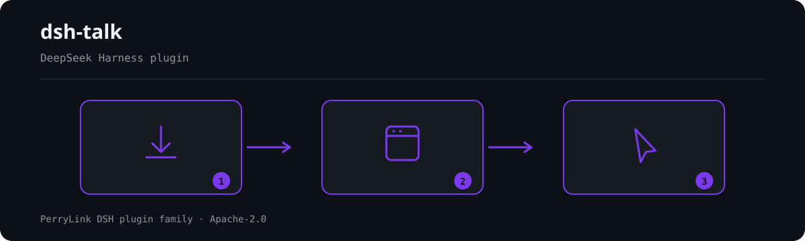

<div align="center">

# 🎙️ dsh-talk
- **1024 store channel**: `npm i -g dsh1024` once, then `dsh1024 plugin --profile web add dsh-talk` (counts toward the [deepseek1024.com](https://deepseek1024.com) install ranking).
[](https://gitee.com/perrylink/dsh-talk)
[](https://dshfind.com/plugins/PerryLink/dsh-talk?ref=badge)
[](https://api.securityscorecards.dev/projects/github.com/PerryLink/dsh-talk)

**Voice-first session loop for DeepSeek Harness: talk to it, hear it answer.**

*Press the mic, speak, and the reply is spoken back — with speak-to-interrupt.*

[](LICENSE)
[](https://github.com/topics/dsh-plugin)
[](https://github.com/PerryLink/dsh-plugin-doctor#verified-徽章)
[](https://dsh.market/)
[](#)
[](https://github.com/PerryLink/dsh-talk/actions)
[](https://github.com/PerryLink/dsh-talk/releases)
[](https://www.npmjs.com/package/dsh-talk)
[](https://www.npmjs.com/package/dsh-talk)

[English](README.md) · [简体中文](README-zh.md) · [Español](README-es.md) · [Português](README-pt.md) · [हिन्दी](README-hi.md)

```sh
dsh plugin --profile <name> add dsh-talk
```


</div>

---

**📖 Ecosystem knowledge base** — measured data, not marketing: [plugin development guide · plugin-selection data · maintenance criteria](https://perrylink.github.io/dsh-plugin-guide/).

<!-- star-cta -->
## Install & uninstall

- **git channel** (latest `main`): `dsh plugin --profile web add github:PerryLink/dsh-talk` — the `prepare` script builds with production dependencies only.
- **npm channel** (published releases): `dsh plugin --profile web add dsh-talk`.
- **tarball channel**: `pnpm pack` in this repo, then `dsh plugin --profile web add ./dsh-talk-<version>.tgz`.
- **uninstall**: `dsh plugin --profile web remove dsh-talk` (or remove the row from the profile patch).

> If pnpm reports `ERR_PNPM_IGNORED_BUILDS` for this package (esbuild's harmless platform-binary validation), add `allowBuilds: { esbuild: true }` to your `pnpm-workspace.yaml` — the `dsh` CLI prints the exact snippet.

## ⭐ 如果它帮到了你

这个插件是 [DSH 插件家族](https://github.com/PerryLink)的一员（95 个，全部 Apache-2.0）。如果你在用，**给个 star** —— 它不会解锁任何功能，但会让下一个人在搜索里更容易找到它。

*English:* part of a 95 plugin family for DeepSeek Harness. If it is useful, **a star helps the next person find it** — nothing is gated behind it.


## What is dsh-talk?

Voice-first session loop for DeepSeek Harness: talk to it, hear it answer.

Press the mic, speak, and the reply is spoken back — with speak-to-interrupt.



*Workflow overview: install → open panel → act. The examples below use the real command surface.*


## Compatibility

| Surface | Status |
|---|---|
| Harness | DeepSeek Harness `dsh-v0.2.1-alpha.1` (adapted 2026-09-24: third peer clause + `engines.dsh` + `manifestVersion: 1`, and the monthly Compat workflow anchored to that line); full gate chain green on 2026-09-24 (dual typecheck rulers, 86 tests, build, self-contained, artifacts, pack). npm dev/test line `0.1.7-rc.2`, peers `>=0.1.2-rc.1 <0.2.0 || >=0.1.5-alpha.1 <0.2.0 || >=0.1.6-0 <0.2.0 || >=0.1.7-0 <0.2.0`. |
| Node | `^22.19.0 \|\| >=24.0.0` |
| Browser | Web Speech + MediaRecorder (Chrome/Edge best); host transcription/TTS engines for the rest |

## What you get

`dsh-talk` closes the voice loop in both directions:

- **`speak` tool** — the agent speaks its replies aloud. TTS engines: the browser voice, `edge-tts` (network neural voices), or `piper` (local). Audio plays in the browser; with a local engine it is also written to a file and the tool result carries the absolute path (`audioPath`) for other tools to consume; on hosts that can carry it, the session log records the sanitized utterance (see Security boundaries).
- **Composer mic button** — press it, speak, and the transcription lands in the input box (or submits directly). STT engines: the browser's Web Speech (interim results included), a FunASR HTTP server, or local `whisper.cpp`.
- **Speak-to-interrupt** — starting to talk stops whatever is playing (client → host over the `talk` Remote namespace).
- **Event announcements** — turn completion, pending approvals (waterfall-safe: never blocks the gate), and errors, with a mute switch and configurable phrases.
- **Settings tab** — engine/language selects and announcement switches, saved as append-only profile-patch operations with backups.

```text
browser                                host
  🎙 press ──▶ interrupt ─────────────────▶ talk/interrupt
  record (MediaRecorder / Web Speech)
  transcribe (browser) or talk/transcribe ─▶ FunASR / whisper.cpp
  setDraft(text) or submit()  ◀── talk:speech projection ── speak tool / announcements
  ▶ play audio (talk/audio or speechSynthesis)
```

## Quick start

```sh
dsh plugin --profile web add github:PerryLink/dsh-talk
```

```sh
# 1. install the bundle into your profile
dsh plugin --profile web add github:PerryLink/dsh-talk

# or from npm (published releases)
dsh plugin --profile web add dsh-talk

# 2. restart and verify the row
dsh --profile web --dump-config | grep -A2 'id: talk'
```

Then press the microphone next to the composer and talk; ask the agent to `speak` its reply:

```
> Say "hello" with the speak tool.
```

## Remote browsers need a secure origin

The browser microphone (`getUserMedia` / Web Speech / MediaRecorder) only works in a
**secure context**: `https://…` or `http://localhost` / `http://127.0.0.1`. A plain
`http://<LAN-IP>:3081` page — including Safari on another machine — will not expose
the microphone, even if the Talk settings are correct.

For a remote browser, use one of:

- open the Web UI through an HTTPS reverse proxy or tunnel;
- SSH-forward the port and open `http://localhost:<port>` on the client;
- keep the UI on the same machine as the browser.

`stt.engine: funasr` / `whisper` changes *where transcription runs*, not the browser
capture permission; recording still needs the secure context.

### Examples

These are the real surfaces; the settings tab and mic button are the UI entry points.

#### Detailed example

**Command**

~~~sh
speak
~~~

**Input**

~~~json
{"text":"hello","engine":"browser"}
~~~

**Output**

~~~text
Spoke hello aloud with the browser engine. No audio file: the browser engine synthesizes in the browser.
~~~

*Observed from `plugins/dsh-talk/tests/lifecycle.spec.ts:124-137; renderer at src/tool.ts:47-64`*

#### Failure branch

**Input**

~~~text
{"text":"   "}
~~~

**Output**

~~~text
Error: dsh-talk: speak text must not be empty
~~~

*Observed from `plugins/dsh-talk/src/tool.ts:124; plugins/dsh-talk/tests/tool.spec.ts:41-44`*

#### Brief examples

- `talk:status`
- `talk:transcribe`

## Configuration

All tunables are Schemastery `Config` fields (changeable from cordis.yml). `cordis.patch.yml` documents each key inline.

| Key | Default | Meaning |
|---|---|---|
| `record.enabled` | `true` | Show the composer mic button |
| `record.hotkey` | *(none)* | Optional toggle hotkey, e.g. `"alt+r"` |
| `record.maxSeconds` | `60` | Recording cap in seconds (1..600) |
| `record.autoSubmit` | `false` | Submit the transcription as a user message (false = fill the draft) |
| `record.vad.enabled` / `silenceMs` / `energyThreshold` | `true` / `1500` / `0.01` | Voice-activity detection: silence auto-ends the recording (degrades when `AudioContext` is absent) |
| `stt.engine` | `auto` | `auto` / `web` / `funasr` / `whisper`; auto prefers a configured local engine, then Web Speech |
| `stt.language` | `auto` | BCP-47 language or `auto` |
| `stt.interim` | `true` | Show interim transcriptions (Web Speech) |
| `stt.silenceFinaliseMs` | `4000` | Stop continuous Web Speech recognition after this many milliseconds without speech (500..15000) |
| `stt.funasr.url` | *(none)* | FunASR inference endpoint; required when the engine is `funasr` |
| `stt.whisper.modelPath` | *(none)* | whisper.cpp model; required when the engine is `whisper` |
| `tts.engine` | `auto` | `auto` / `browser` / `edge-tts` / `piper`; auto prefers piper, then edge-tts, then the browser voice |
| `tts.rate` | `0` | Rate offset in percent (-50..50) for edge-tts/piper |
| `tts.fallbackToBrowser` | `true` | Fall back to the browser voice when a local engine fails |
| `tts.browser.voiceName` | *(none)* | Preferred browser voice name; an unknown name uses the platform default |
| `tts.browser.rate` | `1` | Browser SpeechSynthesis rate (0.1..10) |
| `tts.browser.pitch` | `1` | Browser SpeechSynthesis pitch (0..2) |
| `tts.piper.modelPath` | *(none)* | piper voice model; required when the engine is `piper` |
| `tts.export.enabled` | `true` | Write locally synthesized audio to a file and return its path as `audioPath` |
| `tts.export.dir` | `<home>/.dsh-talk/audio` | Export directory; `~` = home, a relative path resolves under home (never the workspace) |
| `tts.export.maxFiles` | `20` | Files retained in the export directory, counting the one just written (1..1000) |
| `tts.export.maxAgeMinutes` | `1440` | Exported files older than this many minutes are pruned on the next write (1..10080) |
| `announce.enabled` | `true` | Master switch for event announcements |
| `announce.onTurnEnd` / `onApproval` / `onError` | `true` | Which events are spoken |
| `announce.messages.*` | *"Turn complete." etc.* | Spoken phrases |
| `interrupt` | `true` | Talking stops current playback |
| `maxSpeakChars` | `20000` | Cap on the speak tool's text length (1..100000) |
| `maxAudioCacheBytes` | `8388608` | In-memory synthesized-audio cache cap (1 MiB..64 MiB) |

`stt.silenceFinaliseMs` and `record.vad.silenceMs` are separate mechanisms: the first finalises the Web Speech transcript when continuous recognition hears no speech, the second is the MediaRecorder energy-based detector that ends the recording (and submits it when `record.autoSubmit` is on). They run in different pipelines and share no state.

### Audio file export

Every utterance synthesized by a local engine (`edge-tts`, `piper`) is written to a file **in addition to** the in-memory cache the browser plays from. The browser engine synthesizes on the client and therefore exports nothing — that state is reported explicitly, never silently.

- **Where**: `tts.export.dir`, default `<home>/.dsh-talk/audio` — the plugin's own directory. It is deliberately never the host's working directory, so a repository is never polluted; a relative `tts.export.dir` is resolved under the home directory for the same reason.
- **Names**: `speech-<YYYYMMDD>T<HHMMSS>Z-<8 hex>.mp3` (edge-tts) or `.wav` (piper). The stamp is UTC so names sort chronologically, and the token comes from the utterance id, so a file maps back to its `dsh-talk/speech` log entry. The spoken text is never part of a file name.
- **Cleanup**: bounded on every write, age first and count second. Files older than `tts.export.maxAgeMinutes` (default 1440 = 24 h) are removed, then the oldest files are removed until the directory holds at most `tts.export.maxFiles` (default 20, counting the file just written). Pruning only ever unlinks names matching this plugin's own `speech-…` pattern, so other files in a shared directory are never touched. With the defaults the directory holds at most 20 files (~a few MB) and nothing older than a day.
- **Failure**: exporting is an addition to speech, never a precondition. If the directory cannot be created or written, the utterance still plays and the result reports `audioExport: "failed"` with the reason; pruning failures are ignored and retried on the next write.
- **Model-visible path**: the `speak` tool's canonical value carries `audioPath` (plus `audioExport` and, when there is no file, `exportNote`), and the same path is in the rendered result text — so the agent can pass it straight to another tool that takes a file, for example a messenger plugin's file argument. Event announcements (turn end, approval, error) are synthesized through the same pipeline and are exported the same way; they are bounded by the same caps.
- **Handing the file to another plugin**: a consumer that only accepts files inside its own workspace — `dsh-wechat`'s `send_wechat` refuses a `file_path` outside the calling session's workspace unless its own `allowAnyFilePath` setting is on — will reject a path under your home directory. For that flow, point `tts.export.dir` at a directory inside that workspace (for example `<workspace>/.dsh-talk-audio`); the default stays outside every repository on purpose.

## Tools & surfaces

| Surface | Kind | Notes |
|---|---|---|
| `speak` | tool | Speaks text aloud (browser/edge-tts/piper); per-call engine/voice overrides; canonical JSON outcome |
| mic button | `conversation.input.left` slot | Record → transcribe → fill draft (or submit); speak-to-interrupt on press |
| settings tab | `settings.plugins.tab` (id `talk`) | Engine/language/announcement switches; append-only save |
| `talk:*` | Typert Remote | `status`, `audio`, `transcribe`, `applySettings`, `interrupt` (host namespace) |

## Permissions & data

- **Permissions**: the plugin keeps an in-memory, byte-capped audio cache for playback and, for local engines, writes the synthesized audio to its own bounded directory (`tts.export.*`, default `<home>/.dsh-talk/audio`, at most 20 files and 24 h old by default); microphone permission is browser-mediated. The settings tab only appends patch fragments to the profile with a timestamped backup — never rewrites the file.
- **Data**: audio bytes never enter the model context or the session log. Where the host's session vocabulary accepts it, the `dsh-talk/speech` event carries the utterance id, engine, reason, size, sanitized text, and browser voice/rate/pitch when applicable; on envelope-less hosts the event is not written at all. The `speak` tool result carries the exported file's path (a persistent artifact in the plugin's own directory), and everything else on a display/log surface passes the redaction helpers, so credentials, JWTs, bearer headers, and temp paths stay out.
- **Network**: only the engines you configure are contacted. `edge-tts` performs network synthesis, FunASR uses its configured endpoint, and Chrome's `webkitSpeechRecognition` sends microphone audio to Google's servers for transcription; browser `speechSynthesis` playback remains local.

## Security boundaries

- **Model-visible ⟺ logged** — the model sees only the speak tool's canonical value and render text. The `dsh-talk/speech` event is appended only when the host can carry it (see Host compatibility); the `tool/call` + `tool/result` events always remain the reconstructable trail.
- **Approval announcements never block** — the `approval/request` listener always calls `next()`.
- **Sanitized output** — credentials and temp audio paths never reach logs or displays. The one deliberate exception is the exported audio path in the speak result, which is a persistent file in the plugin's own directory (still passed through the secret redactor) and is meant to be handed to another tool.
- **Host compatibility** — the `dsh-talk/speech` event is appended through a yes/no gate. Hosts whose known-type vocabulary covers the event append it, and the call reports that it did; every other host — every released line through `0.1.1-rc.2`, the `0.1.2-alpha` line, `0.1.2-rc.1`, and also `0.1.6-alpha.2`, whose `Session.append` can stamp only the surface intent and not the `ignorable` envelope (that field is retained for stored-log read compatibility only) — gets no append, so speech can never pollute the session log there. The skip is not silent any more: the host keeps per-session appended/skipped counters and `talk/latest(sessionId)` reads them back, the client's session-scoped playback list stays empty, and the speak tool results remain the reconstructable audit trail.
- **Fail loud** — invalid engines, out-of-range values, and engines configured without their required model/endpoint fail the mount.

## Known limitations

- **Browser support**: Web Speech and MediaRecorder are feature-detected; without them the mic button disables itself and host engines (FunASR/whisper.cpp) can still transcribe when configured.
- **Local engines are your install**: `edge-tts`, `piper`, and `whisper.cpp` executables and models must be installed separately.
- **Audio files need a local engine**: the browser voice synthesizes on the client, so `speak` returns no `audioPath` there (the result says so explicitly), and a local engine that fails and falls back to the browser also has no file. Exported files live in the plugin's own bounded directory — see Audio file export for the location, naming, and cleanup rules.
- **Recording format**: the browser records with its native MediaRecorder codec; whisper.cpp may require a WAV-configured recorder or a server-side conversion for other formats.
- **Settings apply on reload**: the settings tab appends to the profile patch; a profile reload (or web-app restart) activates the changes.
- **Live playback history is empty on hosts without the vocabulary**: on `0.1.1-rc.2`, the `0.1.2-alpha` line, `0.1.2-rc.1`, and `0.1.6-alpha.2` the host vocabulary does not know `dsh-talk/speech`, so the gate writes nothing and the client's session-scoped playback list stays empty; `talk/latest(sessionId)` still answers with the newest utterance and the skipped counter. Speech itself, the mic, the settings tab, and the tool are unaffected.
- **Legacy logs written by dsh-talk ≤ 0.2.1 may need repair before cold load**: versions through `0.2.1` appended unmarked `dsh-talk/speech` events. On hosts `0.1.0-rc.7` and newer, a session whose log already contains them fails its next cold load with `SessionFormatUnsupportedError`. Repair: stop the host, back up the session's `.jsonl` log, add `"ignorable":true` as a top-level member of every JSON line whose `"type"` is `"dsh-talk/speech"` (for example, insert `"ignorable":true,` right after the opening `{`), then reopen the session. Nothing else changes and nothing is lost; new appends from this version never add unmarked events.

## Development

```sh
pnpm install        # node ^22.19 || >=24
pnpm run typecheck  # tsc: src + tests against the local harness checkout
pnpm run typecheck:ci  # tsc against the published 0.1.7-alpha.2 types (no paths)
pnpm test           # vitest: 108 tests, 16 suites
pnpm run build      # tsc declarations + tsdown bundles (lib/)
pnpm run verify:self-contained  # dependency specs resolve from the registry
pnpm run verify:artifacts       # built ESM faces + client ModuleLoader handshake
pnpm pack           # the published tarball
```

## Interoperability with other DSH plugins

Verified against **DSH `0.2.0-rc.2`** (the runtime this README ships for) and the high-star plugin set surveyed on 2026-10-05.

This plugin **does not interfere** with other plugins, including the widely installed high-star ones:

- **No tool-name collision.** Every tool is namespaced; no bare name owned by a shipped tool or another plugin is registered.
- **No service-key collision.** It provides `talk`; that key is not a built-in seam and is not provided by any surveyed high-star plugin.
- **No slot collision.** It registers no client slot key, so it cannot contend for a `shadows-shipped-ui` seat.
- **No HTTP route collision.** It registers no `webServer` prefix.
- **No patch-layer collision.** The bundle patch only `insert`s its own row; it never overrides a built-in row's `config`.
- **No global mutation.** It does not patch prototypes, rewrite `process.env`, or replace the global fetch dispatcher.

**Shared event listeners are non-interfering by construction.** It observes the ordering-sensitive event `approval/request` with `ctx.on()` — Cordis's broadcast registration, where every listener runs and none can starve another. **Every listener here delegates through `next()`**, so the chain is never short-circuited, and a mutation is applied to the value `next()` produced rather than returned in its place:

Static evidence: `dsh-plugin-doctor` K10–K13 report `pass` for every check on this repository.

## Topics

`dsh`, `dsh-plugin`, `deepseek-harness`, `deepseek`, `cordis`, `voice`, `speech`, `tts`, `stt`, `speech-to-text`, `text-to-speech`, `microphone`

## Contributors

- [@Mo-Mia](https://github.com/Mo-Mia) — Web Speech privacy/compatibility, composer input actions, language fallback, continuous dictation, `talk:speech` projection, and browser TTS design proposals (#2–#9); several informed the current settings surface.
- [@PerryLink](https://github.com/PerryLink) — creator and maintainer: speak pipeline, speech engines, mic recorder, event announcements, projection unit, and the five-language docs.

## PerryLink DSH Plugin Family

This project is part of the DeepSeek Harness plugin family from [PerryLink](https://github.com/PerryLink). The roster stays collapsed below so every README keeps a short first screen; expand it to see every row and its status.

<details>
<summary>Expand all plugins</summary>

| Plugin | Status |
|---|---|
| **[dsh-aqua-input-check](https://github.com/PerryLink/dsh-aqua-input-check)** |  |
| **[dsh-archive-check](https://github.com/PerryLink/dsh-archive-check)** |  |
| **[dsh-auto-review](https://github.com/PerryLink/dsh-auto-review)** |  |
| **[dsh-autotier](https://github.com/PerryLink/dsh-autotier)** |  |
| **[dsh-bid-ca-precheck](https://github.com/PerryLink/dsh-bid-ca-precheck)** |  |
| **[dsh-bid-qual-check](https://github.com/PerryLink/dsh-bid-qual-check)** |  |
| **[dsh-cert-mcp](https://github.com/PerryLink/dsh-cert-mcp)** |  |
| **[dsh-checkpoint-rewind](https://github.com/PerryLink/dsh-checkpoint-rewind)** |  |
| **[dsh-click](https://github.com/PerryLink/dsh-click)** |  |
| **[dsh-composer-history](https://github.com/PerryLink/dsh-composer-history)** |  |
| **[dsh-contract-stance](https://github.com/PerryLink/dsh-contract-stance)** |  |
| **[dsh-customs-doc-check](https://github.com/PerryLink/dsh-customs-doc-check)** |  |
| **[dsh-data-quality](https://github.com/PerryLink/dsh-data-quality)** |  |
| **[dsh-demurrage-ledger](https://github.com/PerryLink/dsh-demurrage-ledger)** |  |
| **[dsh-doublecheck](https://github.com/PerryLink/dsh-doublecheck)** |  |
| **[dsh-drill-script-check](https://github.com/PerryLink/dsh-drill-script-check)** |  |
| **[dsh-eia-guide-check](https://github.com/PerryLink/dsh-eia-guide-check)** |  |
| **[dsh-emergency-plan](https://github.com/PerryLink/dsh-emergency-plan)** |  |
| **[dsh-essay-rubric-check](https://github.com/PerryLink/dsh-essay-rubric-check)** |  |
| **[dsh-evidence-check](https://github.com/PerryLink/dsh-evidence-check)** |  |
| **[dsh-export-ctl-check](https://github.com/PerryLink/dsh-export-ctl-check)** |  |
| **[dsh-fast](https://github.com/PerryLink/dsh-fast)** |  |
| **[dsh-fmea-table-check](https://github.com/PerryLink/dsh-fmea-table-check)** |  |
| **[dsh-forecast-penalty](https://github.com/PerryLink/dsh-forecast-penalty)** |  |
| **[dsh-fund-research](https://github.com/PerryLink/dsh-fund-research)** |  |
| **[dsh-github](https://github.com/PerryLink/dsh-github)** |  |
| **[dsh-gongwen-flow-check](https://github.com/PerryLink/dsh-gongwen-flow-check)** |  |
| **[dsh-gongwen-word-check](https://github.com/PerryLink/dsh-gongwen-word-check)** |  |
| **[dsh-guard-plan-qc](https://github.com/PerryLink/dsh-guard-plan-qc)** |  |
| **[dsh-hazchem-check](https://github.com/PerryLink/dsh-hazchem-check)** |  |
| **[dsh-hazplan-check](https://github.com/PerryLink/dsh-hazplan-check)** |  |
| **[dsh-hidden-risk-map](https://github.com/PerryLink/dsh-hidden-risk-map)** |  |
| **[dsh-hs-classify](https://github.com/PerryLink/dsh-hs-classify)** |  |
| **[dsh-icd-rule-check](https://github.com/PerryLink/dsh-icd-rule-check)** |  |
| **[dsh-industry-research](https://github.com/PerryLink/dsh-industry-research)** |  |
| **[dsh-lawcite-adapter](https://github.com/PerryLink/dsh-lawcite-adapter)** |  |
| **[dsh-laya](https://github.com/PerryLink/dsh-laya)** |  |
| **[dsh-lc-doc-check](https://github.com/PerryLink/dsh-lc-doc-check)** |  |
| **[dsh-learning-gap-check](https://github.com/PerryLink/dsh-learning-gap-check)** |  |
| **[dsh-library](https://github.com/PerryLink/dsh-library)** |  |
| **[dsh-local-ai](https://github.com/PerryLink/dsh-local-ai)** |  |
| **[dsh-lsp-actions](https://github.com/PerryLink/dsh-lsp-actions)** |  |
| **[dsh-mask](https://github.com/PerryLink/dsh-mask)** |  |
| **[dsh-mcp-panel](https://github.com/PerryLink/dsh-mcp-panel)** |  |
| **[dsh-medrec-qc](https://github.com/PerryLink/dsh-medrec-qc)** |  |
| **[dsh-memento](https://github.com/PerryLink/dsh-memento)** |  |
| **[dsh-nsfc-form-check](https://github.com/PerryLink/dsh-nsfc-form-check)** |  |
| **[dsh-nurse-record-check](https://github.com/PerryLink/dsh-nurse-record-check)** |  |
| **[dsh-observe](https://github.com/PerryLink/dsh-observe)** |  |
| **[dsh-origin-rvc-check](https://github.com/PerryLink/dsh-origin-rvc-check)** |  |
| **[dsh-ota-review-check](https://github.com/PerryLink/dsh-ota-review-check)** |  |
| **[dsh-output-styles](https://github.com/PerryLink/dsh-output-styles)** |  |
| **[dsh-paper-doc-adapter](https://github.com/PerryLink/dsh-paper-doc-adapter)** |  |
| **[dsh-permission-rules](https://github.com/PerryLink/dsh-permission-rules)** |  |
| **[dsh-permit-report-check](https://github.com/PerryLink/dsh-permit-report-check)** |  |
| **[dsh-pipeline-check](https://github.com/PerryLink/dsh-pipeline-check)** |  |
| **[dsh-pleading-draft](https://github.com/PerryLink/dsh-pleading-draft)** |  |
| **[dsh-plugin-doctor](https://github.com/PerryLink/dsh-plugin-doctor)** |  |
| **[dsh-plugin-guide](https://github.com/PerryLink/dsh-plugin-guide)** |  |
| **[dsh-plugin-kit](https://github.com/PerryLink/dsh-plugin-kit)** |  |
| **[dsh-plugin-upgrade](https://github.com/PerryLink/dsh-plugin-upgrade)** |  |
| **[dsh-policy-brief-draft](https://github.com/PerryLink/dsh-policy-brief-draft)** |  |
| **[dsh-power-loss-split](https://github.com/PerryLink/dsh-power-loss-split)** |  |
| **[dsh-power-ticket-check](https://github.com/PerryLink/dsh-power-ticket-check)** |  |
| **[dsh-ppap-check](https://github.com/PerryLink/dsh-ppap-check)** |  |
| **[dsh-protest-deadline](https://github.com/PerryLink/dsh-protest-deadline)** |  |
| **[dsh-railway-window](https://github.com/PerryLink/dsh-railway-window)** |  |
| **[dsh-repair-order-qc](https://github.com/PerryLink/dsh-repair-order-qc)** |  |
| **[dsh-research-report](https://github.com/PerryLink/dsh-research-report)** |  |
| **[dsh-review-reply-check](https://github.com/PerryLink/dsh-review-reply-check)** |  |
| **[dsh-rulefile-check](https://github.com/PerryLink/dsh-rulefile-check)** |  |
| **[dsh-safety-brief-check](https://github.com/PerryLink/dsh-safety-brief-check)** |  |
| **[dsh-score](https://github.com/PerryLink/dsh-score)** |  |
| **[dsh-session-sync](https://github.com/PerryLink/dsh-session-sync)** |  |
| **[dsh-site-log-check](https://github.com/PerryLink/dsh-site-log-check)** |  |
| **[dsh-skill-pack-security](https://github.com/PerryLink/dsh-skill-pack-security)** |  |
| **[dsh-soe-decision-check](https://github.com/PerryLink/dsh-soe-decision-check)** |  |
| **[dsh-soilwater-check](https://github.com/PerryLink/dsh-soilwater-check)** |  |
| **[dsh-sop-sync-check](https://github.com/PerryLink/dsh-sop-sync-check)** |  |
| **[dsh-spc-gbt-adapter](https://github.com/PerryLink/dsh-spc-gbt-adapter)** |  |
| **[dsh-talk](https://github.com/PerryLink/dsh-talk)** |  |
| **[dsh-tender-extract](https://github.com/PerryLink/dsh-tender-extract)** |  |
| **[dsh-tender-matrix](https://github.com/PerryLink/dsh-tender-matrix)** |  |
| **[dsh-test-drive](https://github.com/PerryLink/dsh-test-drive)** |  |
| **[dsh-ticktick](https://github.com/PerryLink/dsh-ticktick)** |  |
| **[dsh-translate](https://github.com/PerryLink/dsh-translate)** |  |
| **[dsh-warranty-calc](https://github.com/PerryLink/dsh-warranty-calc)** |  |
| **[dsh-budget](https://github.com/PerryLink/dsh-budget)** | 🧊 FROZEN — see the repo README |
| **[dsh-claude-move](https://github.com/PerryLink/dsh-claude-move)** | 🧊 FROZEN — see the repo README |
| **[dsh-defend](https://github.com/PerryLink/dsh-defend)** | 🧊 FROZEN — see the repo README |
| **[dsh-draw](https://github.com/PerryLink/dsh-draw)** | 🧊 FROZEN — see the repo README |
| **[dsh-reach](https://github.com/PerryLink/dsh-reach)** | 🧊 FROZEN — see the repo README |
| **[dsh-background-agents](https://github.com/PerryLink/dsh-background-agents)** | 🚫 RETIRED — see the repo README |
| **[dsh-session-pin](https://github.com/PerryLink/dsh-session-pin)** | 🚫 RETIRED — see the repo README |
| **[dsh-team-rooms](https://github.com/PerryLink/dsh-team-rooms)** | 🚫 RETIRED — see the repo README |

</details>

## License

[Apache License 2.0](LICENSE) © 2026 dsh-talk contributors
