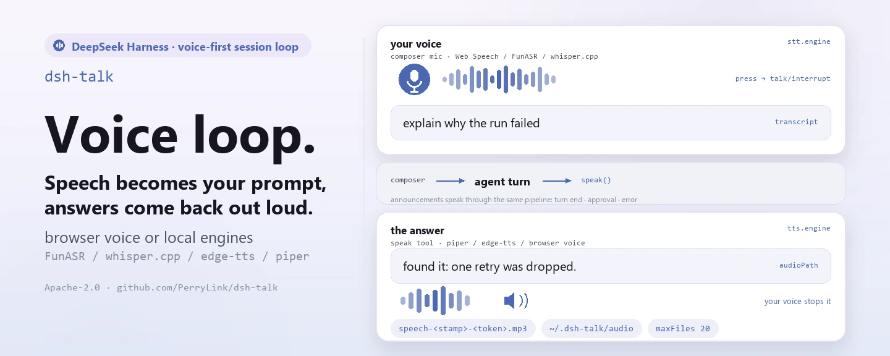

<div align="center">

<picture>
  <source media="(prefers-color-scheme: dark)" srcset="docs/assets/dsh-talk-hero-en-dark.webp">
  
</picture>

# dsh-talk

**Pressione o microfone e fale; a resposta é lida em voz alta — e no momento em que você começa a falar, a reprodução para.**

O laço de sessão voice-first para o DeepSeek Harness: a fala vira texto do compositor, a ferramenta `speak` lê as respostas, fim de turno, aprovações pendentes e erros são anunciados, e todos os motores podem ficar na sua própria máquina.

[Instalar](#instalação-em-três-passos) · [Configuração](#configuração) · [FAQ](#faq) · [简体中文](README.md) · [English](README.en.md) · [Español](README.es.md) · [Português](README.pt.md) · [हिन्दी](README.hi.md)

[](LICENSE)
[](#compatibilidade)
[](https://www.npmjs.com/package/dsh-talk)
[](https://github.com/PerryLink/dsh-talk/actions/workflows/ci.yml)
[](#compatibilidade)

[](https://github.com/PerryLink/dsh-talk/stargazers)
[](https://www.npmjs.com/package/dsh-talk)
[](https://dshfind.com/plugins/PerryLink/dsh-talk?ref=badge)
[](https://securityscorecards.dev/viewer/?uri=github.com/PerryLink/dsh-talk)
[](https://dsh.market/)
[](https://gitee.com/perrylink/dsh-talk)

```sh
dsh plugin --profile <name> add dsh-talk
```

</div>

<sub>Plugin da comunidade, sem afiliação com a DeepSeek. Repositório canônico: <https://github.com/PerryLink/dsh-talk> (o Gitee é um espelho).</sub>

## O que é

`dsh-talk` acrescenta as duas metades da voz ao DeepSeek Harness. Na entrada, o botão de microfone ao lado do compositor grava, e o Web Speech do navegador, um servidor HTTP FunASR ou um `whisper.cpp` local transformam o áudio em texto que preenche o rascunho ou o envia. Na saída, o agente chama a ferramenta `speak` e a voz do navegador, o `edge-tts` ou o `piper` transformam o texto em som. Fim de turno, aprovações pendentes e erros podem ser anunciados automaticamente, e no momento em que você começa a falar a reprodução atual para — não é necessária nenhuma conta na nuvem e os motores locais podem funcionar totalmente offline.

<picture>
  <source media="(prefers-color-scheme: dark)" srcset="docs/assets/dsh-talk-flow-v5-dark.svg">
  
</picture>

*Estrutura: uma fronteira navegador / host e dois canais opostos — a fala de entrada cruza `talk/transcribe` para a escada de motores do host (FunASR → whisper.cpp → Web Speech do navegador) e a transcrição volta como rascunho; a dobradiça `agent turn` entrega a mensagem a `speak()` e aos três eventos de anúncio; a saída percorre a escada TTS (piper → edge-tts → voz do navegador) até o cache e o diretório de exportação limitado, e volta à reprodução por `talk/audio`; o trilho de interrupção fecha o laço à esquerda e a escrita de ajustes corre por baixo.*

## Instalação em três passos

1. **Instale** (escolha um canal):

   ```sh
   # canal git (main mais recente; equivale a git+https://github.com/PerryLink/dsh-talk.git)
   dsh plugin --profile web add github:PerryLink/dsh-talk
   # canal npm (versões publicadas)
   dsh plugin --profile web add dsh-talk
   # canal tarball: pnpm pack neste repo e depois
   dsh plugin --profile web add ./dsh-talk-<version>.tgz
   ```

   O script `prepare` do canal git compila apenas com dependências de produção, então nenhuma cadeia de ferramentas extra é necessária.

2. **Configuração mínima** (os padrões já funcionam):

   De fábrica os motores do navegador bastam: o botão de microfone transcreve com Web Speech e o `speak` reproduz via SpeechSynthesis. Para usar motores locais, acrescente os caminhos dos modelos nesta forma:

   ```yaml
   - insert:
       - id: talk
         name: dsh-talk
         config:
           stt:
             engine: whisper
             whisper:
               modelPath: ~/models/whisper/ggml-small.bin
           tts:
             engine: piper
             piper:
               modelPath: ~/models/piper/zh_CN-huayan-medium.onnx
   ```

3. **Verifique se está ativo**:

   ```sh
   dsh --profile web --dump-config | grep -A2 'id: talk'
   ```

   Depois pressione o microfone ao lado do compositor e fale; ou peça ao agente para ler a resposta:

   ```
   > Say "hello" with the speak tool.
   ```

**Desinstalar**: `dsh plugin --profile web remove dsh-talk` (ou remova a linha do patch do perfil).

> Se o pnpm reportar `ERR_PNPM_IGNORED_BUILDS` para este pacote (a validação inofensiva do binário de plataforma do esbuild), adicione `allowBuilds: { esbuild: true }` ao seu `pnpm-workspace.yaml` — a CLI do `dsh` imprime o trecho exato.

<details>
<summary>Instalar pelo mercado do DSH Desktop</summary>

Todos os plugins da PerryLink podem ser explorados no mercado embutido no DSH Desktop: **Mercado → Fontes → Adicionar fonte → colar** `https://perrylink-dsh-catalog.perrylink.workers.dev/catalog-source.json` **→ selecionar**. A instalação continua passando pela verificação de identidade npm do mercado e pela sua confirmação.

</details>

### Navegadores remotos precisam de uma origem segura

O microfone do navegador (`getUserMedia` / Web Speech / MediaRecorder) só funciona em um
**contexto seguro**: `https://…` ou `http://localhost` / `http://127.0.0.1`. Uma página
`http://<LAN-IP>:3081` comum — incluindo o Safari em outra máquina — não exporá o microfone,
mesmo que os ajustes do Talk estejam corretos.

Para um navegador remoto, use uma destas opções:

- abrir a UI web por um proxy reverso ou túnel HTTPS;
- encaminhar a porta por SSH e abrir `http://localhost:<port>` no cliente;
- manter a UI na mesma máquina do navegador.

`stt.engine: funasr` / `whisper` muda *onde a transcrição roda*, não a permissão
de captura do navegador; gravar ainda exige o contexto seguro.

## Capacidades principais

`dsh-talk` fecha o laço de voz nas duas direções:

- **Ferramenta `speak`** — o agente lê suas respostas em voz alta. Motores TTS: a voz do navegador, o `edge-tts` (vozes neurais pela rede) ou o `piper` (local). O áudio toca no navegador; com um motor local ele também é gravado em um arquivo e o resultado da ferramenta carrega o caminho absoluto (`audioPath`) para outras ferramentas consumirem; nos hosts que conseguem transportá-lo, o registro de sessão anota o enunciado higienizado (ver Limites de segurança).
- **Botão de microfone do compositor** — pressione, fale, e a transcrição vai para a caixa de entrada (ou é enviada direto). Motores STT: Web Speech do navegador (com resultados intermediários), um servidor HTTP FunASR ou `whisper.cpp` local.
- **Falar interrompe** — começar a falar detém o que estiver tocando (cliente → host pelo namespace Remote `talk`).
- **Anúncios de eventos** — fim de turno, aprovações pendentes (seguro para waterfall: nunca bloqueia o portão) e erros, com interruptor de silêncio e frases configuráveis.
- **Aba de ajustes** — seletores de motor/idioma e interruptores de anúncios, salvos como operações append-only do patch do perfil com backups.

```text
browser                                host
  🎙 press ──▶ interrupt ─────────────────▶ talk/interrupt
  record (MediaRecorder / Web Speech)
  transcribe (browser) or talk/transcribe ─▶ FunASR / whisper.cpp
  setDraft(text) or submit()  ◀── talk:speech projection ── speak tool / announcements
  ▶ play audio (talk/audio or speechSynthesis)
```

### Ferramentas e superfícies

| Superfície | Tipo | Notas |
|---|---|---|
| `speak` | ferramenta | Lê texto em voz alta (browser/edge-tts/piper); permite sobrescrever motor/voz por chamada; resultado JSON canônico |
| botão de microfone | slot `conversation.input.left` | Gravar → transcrever → preencher o rascunho (ou enviar); ao pressionar, interrompe a reprodução |
| aba de ajustes | `settings.plugins.tab` (id `talk`) | Interruptores de motor/idioma/anúncios; gravação append-only |
| `talk:*` | Typert Remote | `status`, `audio`, `transcribe`, `applySettings`, `interrupt` (namespace do host) |

### Exemplos

Estas são as superfícies reais; a aba de ajustes e o botão de microfone são os pontos de entrada da UI.

**Exemplo detalhado** — comando `speak`, entrada:

```json
{"text":"hello","engine":"browser"}
```

Saída:

```text
Spoke hello aloud with the browser engine. No audio file: the browser engine synthesizes in the browser.
```

*Observed from `plugins/dsh-talk/tests/lifecycle.spec.ts:124-137; renderer at src/tool.ts:47-64`*

**Ramo de falha** — entrada:

```text
{"text":"   "}
```

Saída:

```text
Error: dsh-talk: speak text must not be empty
```

*Observed from `plugins/dsh-talk/src/tool.ts:124; plugins/dsh-talk/tests/tool.spec.ts:41-44`*

**Exemplos curtos**: `talk:status` · `talk:transcribe`

## Configuração

Todos os ajustes são campos Schemastery `Config` (alteráveis no cordis.yml). O `cordis.patch.yml` documenta cada chave em linha.

Chaves mais usadas:

| Chave | Padrão | Significado |
|---|---|---|
| `record.enabled` | `true` | Mostrar o botão de microfone do compositor |
| `record.autoSubmit` | `false` | Enviar a transcrição como mensagem do usuário (false = preencher o rascunho) |
| `stt.engine` | `auto` | `auto` / `web` / `funasr` / `whisper`; auto prefere um motor local configurado e depois Web Speech |
| `tts.engine` | `auto` | `auto` / `browser` / `edge-tts` / `piper`; auto prefere piper, depois edge-tts e por fim a voz do navegador |
| `tts.export.dir` | `<home>/.dsh-talk/audio` | Diretório de exportação; `~` = home, um caminho relativo é resolvido sob o home (nunca o workspace) |
| `announce.enabled` | `true` | Interruptor mestre dos anúncios de eventos |
| `interrupt` | `true` | Falar detém a reprodução atual |
| `maxSpeakChars` | `20000` | Limite de comprimento do texto da ferramenta speak (1..100000) |

<details>
<summary>Tabela de configuração completa (28 chaves)</summary>

| Chave | Padrão | Significado |
|---|---|---|
| `record.enabled` | `true` | Mostrar o botão de microfone do compositor |
| `record.hotkey` | *(nenhum)* | Atalho de alternância opcional, por exemplo `"alt+r"` |
| `record.maxSeconds` | `60` | Limite de gravação em segundos (1..600) |
| `record.autoSubmit` | `false` | Enviar a transcrição como mensagem do usuário (false = preencher o rascunho) |
| `record.vad.enabled` / `silenceMs` / `energyThreshold` | `true` / `1500` / `0.01` | Detecção de atividade de voz: o silêncio encerra a gravação (degrada quando falta `AudioContext`) |
| `stt.engine` | `auto` | `auto` / `web` / `funasr` / `whisper`; auto prefere um motor local configurado e depois Web Speech |
| `stt.language` | `auto` | Idioma BCP-47 ou `auto` |
| `stt.interim` | `true` | Mostrar transcrições intermediárias (Web Speech) |
| `stt.silenceFinaliseMs` | `4000` | Parar o reconhecimento Web Speech contínuo após estes milissegundos sem fala (500..15000) |
| `stt.funasr.url` | *(nenhum)* | Endpoint de inferência FunASR; obrigatório quando o motor é `funasr` |
| `stt.whisper.modelPath` | *(nenhum)* | Modelo whisper.cpp; obrigatório quando o motor é `whisper` |
| `tts.engine` | `auto` | `auto` / `browser` / `edge-tts` / `piper`; auto prefere piper, depois edge-tts e por fim a voz do navegador |
| `tts.rate` | `0` | Deslocamento de velocidade em porcentagem (-50..50) para edge-tts/piper |
| `tts.fallbackToBrowser` | `true` | Voltar à voz do navegador quando um motor local falha |
| `tts.browser.voiceName` | *(nenhum)* | Nome de voz preferido do navegador; um nome desconhecido usa o padrão da plataforma |
| `tts.browser.rate` | `1` | Velocidade do SpeechSynthesis do navegador (0.1..10) |
| `tts.browser.pitch` | `1` | Tom do SpeechSynthesis do navegador (0..2) |
| `tts.piper.modelPath` | *(nenhum)* | Modelo de voz piper; obrigatório quando o motor é `piper` |
| `tts.export.enabled` | `true` | Gravar o áudio sintetizado localmente em um arquivo e devolver o caminho como `audioPath` |
| `tts.export.dir` | `<home>/.dsh-talk/audio` | Diretório de exportação; `~` = home, um caminho relativo é resolvido sob o home (nunca o workspace) |
| `tts.export.maxFiles` | `20` | Arquivos mantidos no diretório de exportação, contando o recém-gravado (1..1000) |
| `tts.export.maxAgeMinutes` | `1440` | Arquivos exportados mais antigos que estes minutos são podados na próxima gravação (1..10080) |
| `announce.enabled` | `true` | Interruptor mestre dos anúncios de eventos |
| `announce.onTurnEnd` / `onApproval` / `onError` | `true` | Quais eventos são anunciados |
| `announce.messages.*` | *"Turn complete." etc.* | Frases faladas |
| `interrupt` | `true` | Falar detém a reprodução atual |
| `maxSpeakChars` | `20000` | Limite de comprimento do texto da ferramenta speak (1..100000) |
| `maxAudioCacheBytes` | `8388608` | Limite do cache de áudio sintetizado em memória (1 MiB..64 MiB) |

</details>

`stt.silenceFinaliseMs` e `record.vad.silenceMs` são mecanismos separados: o primeiro finaliza a transcrição do Web Speech quando o reconhecimento contínuo não ouve fala, o segundo é o detector por energia do MediaRecorder que encerra a gravação (e a envia quando `record.autoSubmit` está ligado). Eles rodam em pipelines diferentes e não compartilham estado.

### Exportação de arquivos de áudio

Cada enunciado sintetizado por um motor local (`edge-tts`, `piper`) é gravado em um arquivo **além** do cache em memória de onde o navegador reproduz. O motor do navegador sintetiza no cliente e, portanto, não exporta nada — esse estado é informado explicitamente, nunca em silêncio.

- **Onde**: `tts.export.dir`, padrão `<home>/.dsh-talk/audio` — o diretório do próprio plugin. Ele deliberadamente nunca é o diretório de trabalho do host, então um repositório jamais é poluído; um `tts.export.dir` relativo é resolvido sob o diretório home pelo mesmo motivo.
- **Nomes**: `speech-<YYYYMMDD>T<HHMMSS>Z-<8 hex>.mp3` (edge-tts) ou `.wav` (piper). A marca é UTC, então os nomes ordenam cronologicamente, e o token vem do id do enunciado, de modo que um arquivo remete à sua entrada de log `dsh-talk/speech`. O texto falado nunca faz parte do nome.
- **Limpeza**: limitada a cada gravação, primeiro por idade e depois por quantidade. Arquivos mais antigos que `tts.export.maxAgeMinutes` (padrão 1440 = 24 h) são removidos, depois os mais velhos até o diretório conter no máximo `tts.export.maxFiles` (padrão 20, contando o recém-gravado). A poda só apaga nomes que casam com o padrão `speech-…` do próprio plugin, então outros arquivos em um diretório compartilhado nunca são tocados. Com os padrões o diretório guarda no máximo 20 arquivos (alguns MB) e nada com mais de um dia.
- **Falha**: exportar é um acréscimo à fala, nunca uma pré-condição. Se o diretório não puder ser criado ou gravado, o enunciado toca mesmo assim e o resultado informa `audioExport: "failed"` com o motivo; falhas de poda são ignoradas e repetidas na próxima gravação.
- **Caminho visível para o modelo**: o valor canônico da ferramenta `speak` carrega `audioPath` (mais `audioExport` e, quando não há arquivo, `exportNote`), e o mesmo caminho está no texto renderizado do resultado — assim o agente pode passá-lo direto a outra ferramenta que aceite um arquivo, por exemplo o argumento de arquivo de um plugin de mensageria. Os anúncios de eventos (fim de turno, aprovação, erro) são sintetizados pelo mesmo pipeline e exportados do mesmo jeito; estão sujeitos aos mesmos limites.
- **Entregar o arquivo a outro plugin**: um consumidor que só aceita arquivos dentro do próprio workspace — o `send_wechat` do `dsh-wechat` recusa um `file_path` fora do workspace da sessão chamadora a menos que o ajuste `allowAnyFilePath` dele esteja ligado — vai recusar um caminho sob o seu diretório home. Para esse fluxo, aponte `tts.export.dir` para um diretório dentro desse workspace (por exemplo `<workspace>/.dsh-talk-audio`); o padrão fica fora de todo repositório de propósito.

Exemplo de sobrescrita do patch do perfil:

```yaml
- insert:
    - id: talk
      name: dsh-talk
      config:
        tts:
          rate: 10
          fallbackToBrowser: false
        announce:
          onApproval: false
```

## FAQ

<details>
<summary>Onde ficam o áudio e a transcrição? Algo chega ao registro de sessão?</summary>

Os bytes de áudio só entram no cache em memória (`maxAudioCacheBytes`, 8 MiB por padrão) e, com motores locais, no diretório de exportação (`tts.export.*`, no máximo 20 arquivos e 24 h por padrão) — **nunca** no contexto do modelo nem no registro de sessão. O evento `dsh-talk/speech` é gravado apenas onde o vocabulário do host o aceita, e carrega só o id do enunciado, o motor, o motivo, o tamanho, o texto higienizado e os parâmetros de voz do navegador quando aplicáveis. O único caminho de arquivo persistente é `audioPath` — ele existe para ser entregue a outra ferramenta, então sim, aparece no resultado do `speak`.

</details>

<details>
<summary>O que acontece em hosts que não conhecem `dsh-talk/speech`? Falha em silêncio?</summary>

Não. Em `0.1.1-rc.2`, na linha `0.1.2-alpha`, em `0.1.2-rc.1` e em `0.1.6-alpha.2` o vocabulário do host não conhece o evento, o portão não grava nada e a lista de reprodução da sessão no cliente fica vazia; mas o host mantém contadores por sessão de adicionados/omitidos que o `talk/latest(sessionId)` devolve, e os resultados da ferramenta speak continuam sendo o rastro auditável reconstruível. A fala, o microfone, a aba de ajustes e a ferramenta não são afetados.

</details>

<details>
<summary>Vai brigar com outros plugins por nomes de ferramentas, chaves de serviço ou slots?</summary>

Não. Toda ferramenta tem namespace, ele fornece exatamente uma chave de serviço (`talk`, que não é um seam embutido nem é fornecida por nenhum plugin de muitas estrelas pesquisado), não registra nenhuma chave de slot de cliente, não registra nenhum prefixo `webServer` e não muta globais. O listener de `approval/request`, sensível à ordem, sempre delega via `next()`, então a cadeia nunca é curto-circuitada. O argumento completo está em «Interoperabilidade com outros plugins DSH».

</details>

<details>
<summary>Qual é o custo de desempenho?</summary>

Não há chamadas extras ao modelo. A transcrição acontece no navegador ou no motor que você configurar; o TTS local dispara um subprocesso por enunciado, o áudio vai para um cache em memória limitado e as gravações de exportação usam a poda bidimensional (primeiro idade, depois quantidade). Os anúncios de eventos são fire-and-forget, e `approval/request` apenas inicia um enunciado assíncrono — nunca bloqueia a aprovação.

</details>

## Limites de segurança

- **Visível para o modelo ⟺ registrado** — o modelo só vê o valor canônico e o texto renderizado da ferramenta speak. O evento `dsh-talk/speech` só é adicionado quando o host consegue transportá-lo (ver Compatibilidade do host); os eventos `tool/call` + `tool/result` continuam sempre sendo o rastro reconstruível.
- **Anúncios de aprovação nunca bloqueiam** — o listener de `approval/request` sempre chama `next()`.
- **Saída higienizada** — credenciais e caminhos de áudio temporários nunca chegam a logs ou telas. A única exceção deliberada é o caminho do áudio exportado no resultado do speak, que é um arquivo persistente do diretório do próprio plugin (ainda passa pelo removedor de segredos) e existe para ser entregue a outra ferramenta.
- **Compatibilidade do host** — o evento `dsh-talk/speech` é adicionado por um portão sim/não. Hosts cujo vocabulário de tipos conhecidos cobre o evento o adicionam, e a chamada informa que o fez; qualquer outro host — todas as linhas publicadas até `0.1.1-rc.2`, a linha `0.1.2-alpha`, `0.1.2-rc.1` e também `0.1.6-alpha.2`, cujo `Session.append` só consegue carimbar a intenção de superfície e não o envelope `ignorable` (esse campo é mantido só por compatibilidade de leitura de logs guardados) — não recebe adição alguma, então a fala nunca pode poluir o registro de sessão ali. A omissão não é mais silenciosa: o host mantém contadores por sessão de adicionados/omitidos, o `talk/latest(sessionId)` os devolve, a lista de reprodução da sessão no cliente fica vazia e os resultados da ferramenta speak continuam sendo o rastro auditável reconstruível.
- **Falha ruidosa** — motores inválidos, valores fora da faixa e motores configurados sem o modelo/endpoint obrigatório falham na montagem.

## Permissões e dados

- **Permissões**: o plugin mantém um cache de áudio em memória e limitado por bytes para reprodução e, com motores locais, grava o áudio sintetizado no próprio diretório limitado (`tts.export.*`, padrão `<home>/.dsh-talk/audio`, no máximo 20 arquivos e 24 h por padrão); a permissão de microfone é mediada pelo navegador. A aba de ajustes só acrescenta fragmentos de patch ao perfil com um backup com carimbo de tempo — nunca reescreve o arquivo.
- **Dados**: bytes de áudio nunca entram no contexto do modelo nem no registro de sessão. Onde o vocabulário de sessão do host aceita, o evento `dsh-talk/speech` carrega o id do enunciado, o motor, o motivo, o tamanho, o texto higienizado e voz/velocidade/tom do navegador quando aplicáveis; em hosts sem envelope o evento não é gravado de forma alguma. O resultado da ferramenta `speak` carrega o caminho do arquivo exportado (um artefato persistente do diretório do próprio plugin), e todo o resto em uma superfície de tela/log passa pelos auxiliares de redação, então credenciais, JWTs, cabeçalhos bearer e caminhos temporários ficam de fora.
- **Rede**: só os motores que você configurar são contatados. O `edge-tts` faz síntese pela rede, o FunASR usa o endpoint configurado, e o `webkitSpeechRecognition` do Chrome envia o áudio do microfone aos servidores do Google para transcrever; a reprodução com `speechSynthesis` do navegador continua local.

## Limitações conhecidas

- **Suporte de navegador**: Web Speech e MediaRecorder são detectados por características; sem eles o botão de microfone se desativa e os motores do host (FunASR/whisper.cpp) ainda podem transcrever se configurados.
- **Motores locais são instalação sua**: os executáveis e modelos de `edge-tts`, `piper` e `whisper.cpp` precisam ser instalados separadamente.
- **Arquivos de áudio exigem um motor local**: a voz do navegador sintetiza no cliente, então ali o `speak` não devolve `audioPath` (o resultado diz isso explicitamente), e um motor local que falha e cai para o navegador também não tem arquivo. Os arquivos exportados vivem no diretório limitado do próprio plugin — veja «Exportação de arquivos de áudio» para local, nomes e limpeza.
- **Formato de gravação**: o navegador grava com o codec nativo do MediaRecorder; o whisper.cpp pode exigir um gravador configurado em WAV ou uma conversão no servidor para outros formatos.
- **Ajustes aplicam ao recarregar**: a aba de ajustes acrescenta ao patch do perfil; uma recarga do perfil (ou reinício do web-app) ativa as mudanças.
- **O histórico de reprodução ao vivo fica vazio em hosts sem o vocabulário**: em `0.1.1-rc.2`, na linha `0.1.2-alpha`, em `0.1.2-rc.1` e em `0.1.6-alpha.2` o vocabulário do host não conhece `dsh-talk/speech`, então o portão não grava nada e a lista de reprodução da sessão no cliente fica vazia; o `talk/latest(sessionId)` continua respondendo com o enunciado mais recente e o contador de omitidos. A fala em si, o microfone, a aba de ajustes e a ferramenta não são afetados.
- **Logs antigos gravados pelo dsh-talk ≤ 0.2.1 podem precisar de reparo antes da carga fria**: versões até `0.2.1` adicionavam eventos `dsh-talk/speech` sem marcação. Em hosts `0.1.0-rc.7` e mais novos, uma sessão cujo log já os contém falha na carga fria seguinte com `SessionFormatUnsupportedError`. Reparo: pare o host, faça backup do log `.jsonl` da sessão, acrescente `"ignorable":true` como membro de nível superior de cada linha JSON cujo `"type"` seja `"dsh-talk/speech"` (por exemplo, insira `"ignorable":true,` logo depois da `{` de abertura) e reabra a sessão. Nada mais muda e nada se perde; novas adições desta versão nunca produzem eventos sem marcação.

## Interoperabilidade com outros plugins DSH

Verificado contra **DSH `0.2.0-rc.2`** (o runtime para o qual este README é publicado) e o conjunto de plugins de muitas estrelas pesquisado em 2026-10-05.

Este plugin **não interfere** com outros plugins, incluindo os de muitas estrelas amplamente instalados:

- **Sem colisão de nomes de ferramenta.** Toda ferramenta tem namespace; nenhum nome nu de uma ferramenta embutida ou de outro plugin é registrado.
- **Sem colisão de chaves de serviço.** Ele fornece apenas `talk`; essa chave não é um seam embutido e não é fornecida por nenhum plugin de muitas estrelas pesquisado.
- **Sem colisão de slots.** Não registra nenhuma chave de slot de cliente, então não pode disputar um assento de `shadows-shipped-ui`.
- **Sem colisão de rotas HTTP.** Não registra nenhum prefixo `webServer`.
- **Sem colisão de camadas de patch.** O patch do bundle só faz `insert` da própria linha; nunca sobrescreve o `config` de uma linha embutida.
- **Sem mutação global.** Não faz patch de protótipos, não reescreve `process.env` nem substitui o dispatcher global de fetch.

**Listeners de eventos compartilhados não interferem por construção.** Ele observa o evento sensível à ordem `approval/request` com `ctx.on()` — o registro de broadcast do Cordis, em que cada listener roda e nenhum pode matar de fome outro. **Aqui cada listener delega via `next()`**, então a cadeia nunca é curto-circuitada, e uma mutação é aplicada ao valor que `next()` produziu em vez de ser devolvida no lugar dele:

Evidência estática: o `dsh-plugin-doctor` K10–K13 informa `pass` em todas as verificações deste repositório.

## Compatibilidade

| Superfície | Status |
|---|---|
| Harness | DeepSeek Harness `dsh-v0.2.1-alpha.1` (adaptado em 2026-09-24: terceira cláusula peer + `engines.dsh` + `manifestVersion: 1`, e o workflow Compat mensal ancorado nessa linha); cadeia completa de portões verde em 2026-09-24 (réguas duplas de typecheck, 86 testes, build, self-contained, artifacts, pack). Linha npm de desenvolvimento/teste `0.1.7-rc.2`, peers `>=0.1.2-rc.1 <0.2.0 || >=0.1.5-alpha.1 <0.2.0 || >=0.1.6-0 <0.2.0 || >=0.1.7-0 <0.2.0`. |
| Node | `^22.19.0 \|\| >=24.9.0` |
| Navegador | Web Speech + MediaRecorder (melhor no Chrome/Edge); motores de transcrição/TTS do host para o resto |

## Ecossistema e qualidade

- [Espelho no Gitee](https://gitee.com/perrylink/dsh-talk) (espelho sincronizado; o GitHub é canônico)
- [Página do plugin no dshfind](https://dshfind.com/plugins/PerryLink/dsh-talk) (instalações e ranking)
- [Relatório do OpenSSF Scorecard](https://securityscorecards.dev/viewer/?uri=github.com/PerryLink/dsh-talk) (movido por [.github/workflows/scorecard.yml](.github/workflows/scorecard.yml))
- [Relatório de verificação do dsh-plugin-doctor](https://github.com/PerryLink/dsh-plugin-doctor#verified-徽章) (K10–K13 tudo `pass`)
- [DSH Market](https://dsh.market/) (listado)
- **Canal da loja 1024**: `npm i -g dsh1024` uma vez e depois `dsh1024 plugin --profile web add dsh-talk` (conta para o ranking de instalações do [deepseek1024.com](https://deepseek1024.com))
- [Base de conhecimento do ecossistema](https://perrylink.github.io/dsh-plugin-guide/): guia de desenvolvimento de plugins · dados de seleção · critérios de manutenção

## Desenvolvimento

```sh
pnpm install        # node ^22.19 || >=24.9
pnpm run typecheck  # tsc: src + tests contra o checkout local do harness
pnpm run typecheck:ci  # tsc contra os tipos publicados 0.1.7-alpha.2 (sem paths)
pnpm test           # vitest: 108 testes, 16 suítes
pnpm run build      # declarações tsc + bundles tsdown (lib/)
pnpm run verify:self-contained  # as declarações de dependência resolvem pelo registry
pnpm run verify:artifacts       # faces ESM construídas + handshake ModuleLoader do cliente
pnpm run check:readmes          # consistência dos README em cinco idiomas
pnpm pack           # o tarball publicado
```

As imagens do README são geradas por [`scripts/gen-readme-assets.py`](scripts/gen-readme-assets.py) (Python + Pillow para o hero, SVG escrito à mão para o mapa de estrutura): `docs/assets/dsh-talk-hero-{zh,en}-{light,dark}.webp` e `docs/assets/dsh-talk-flow-v5-{light,dark}.svg`, e pode ser reexecutado com segurança.

Topics: `dsh`, `dsh-plugin`, `deepseek-harness`, `deepseek`, `cordis`, `voice`, `speech`, `tts`, `stt`, `speech-to-text`, `text-to-speech`, `microphone`

## Família e agradecimentos

Este projeto faz parte da família de plugins do DeepSeek Harness da [PerryLink](https://github.com/PerryLink) (95 plugins, todos Apache-2.0). Se ele for útil, **uma estrela ajuda a próxima pessoa a encontrá-lo** — nada fica bloqueado por trás dela.

- [@PerryLink](https://github.com/PerryLink) — criador e mantenedor: pipeline de fala, motores de voz, gravador de microfone, anúncios de eventos, unidade de projeção e a documentação em cinco idiomas.
- [@Mo-Mia](https://github.com/Mo-Mia) — privacidade/compatibilidade do Web Speech, ações de entrada do compositor, fallback de idioma, ditado contínuo, projeção `talk:speech` e propostas de design de TTS do navegador (#2–#9); várias influenciaram a superfície de ajustes atual.

<details>
<summary>Expandir todos os plugins</summary>

| Plugin | Status |
|---|---|
| **[dsh-aqua-input-check](https://github.com/PerryLink/dsh-aqua-input-check)** |  |
| **[dsh-archive-check](https://github.com/PerryLink/dsh-archive-check)** |  |
| **[dsh-auto-review](https://github.com/PerryLink/dsh-auto-review)** |  |
| **[dsh-autotier](https://github.com/PerryLink/dsh-autotier)** | 🧊 CONGELADO — ver o README do repo |
| **[dsh-bid-ca-precheck](https://github.com/PerryLink/dsh-bid-ca-precheck)** |  |
| **[dsh-bid-qual-check](https://github.com/PerryLink/dsh-bid-qual-check)** |  |
| **[dsh-cert-mcp](https://github.com/PerryLink/dsh-cert-mcp)** | 🧊 CONGELADO — ver o README do repo |
| **[dsh-checkpoint-rewind](https://github.com/PerryLink/dsh-checkpoint-rewind)** |  |
| **[dsh-click](https://github.com/PerryLink/dsh-click)** |  |
| **[dsh-composer-history](https://github.com/PerryLink/dsh-composer-history)** |  |
| **[dsh-contract-stance](https://github.com/PerryLink/dsh-contract-stance)** |  |
| **[dsh-customs-doc-check](https://github.com/PerryLink/dsh-customs-doc-check)** |  |
| **[dsh-data-quality](https://github.com/PerryLink/dsh-data-quality)** | 🧊 CONGELADO — ver o README do repo |
| **[dsh-demurrage-ledger](https://github.com/PerryLink/dsh-demurrage-ledger)** |  |
| **[dsh-doublecheck](https://github.com/PerryLink/dsh-doublecheck)** |  |
| **[dsh-drill-script-check](https://github.com/PerryLink/dsh-drill-script-check)** |  |
| **[dsh-eia-guide-check](https://github.com/PerryLink/dsh-eia-guide-check)** |  |
| **[dsh-emergency-plan](https://github.com/PerryLink/dsh-emergency-plan)** |  |
| **[dsh-essay-rubric-check](https://github.com/PerryLink/dsh-essay-rubric-check)** |  |
| **[dsh-evidence-check](https://github.com/PerryLink/dsh-evidence-check)** |  |
| **[dsh-export-ctl-check](https://github.com/PerryLink/dsh-export-ctl-check)** |  |
| **[dsh-fast](https://github.com/PerryLink/dsh-fast)** |  |
| **[dsh-fmea-table-check](https://github.com/PerryLink/dsh-fmea-table-check)** |  |
| **[dsh-forecast-penalty](https://github.com/PerryLink/dsh-forecast-penalty)** |  |
| **[dsh-fund-research](https://github.com/PerryLink/dsh-fund-research)** |  |
| **[dsh-github](https://github.com/PerryLink/dsh-github)** |  |
| **[dsh-gongwen-flow-check](https://github.com/PerryLink/dsh-gongwen-flow-check)** |  |
| **[dsh-gongwen-word-check](https://github.com/PerryLink/dsh-gongwen-word-check)** |  |
| **[dsh-guard-plan-qc](https://github.com/PerryLink/dsh-guard-plan-qc)** |  |
| **[dsh-hazchem-check](https://github.com/PerryLink/dsh-hazchem-check)** |  |
| **[dsh-hazplan-check](https://github.com/PerryLink/dsh-hazplan-check)** |  |
| **[dsh-hidden-risk-map](https://github.com/PerryLink/dsh-hidden-risk-map)** |  |
| **[dsh-hs-classify](https://github.com/PerryLink/dsh-hs-classify)** |  |
| **[dsh-icd-rule-check](https://github.com/PerryLink/dsh-icd-rule-check)** |  |
| **[dsh-industry-research](https://github.com/PerryLink/dsh-industry-research)** |  |
| **[dsh-lawcite-adapter](https://github.com/PerryLink/dsh-lawcite-adapter)** |  |
| **[dsh-laya](https://github.com/PerryLink/dsh-laya)** |  |
| **[dsh-lc-doc-check](https://github.com/PerryLink/dsh-lc-doc-check)** |  |
| **[dsh-learning-gap-check](https://github.com/PerryLink/dsh-learning-gap-check)** |  |
| **[dsh-library](https://github.com/PerryLink/dsh-library)** |  |
| **[dsh-local-ai](https://github.com/PerryLink/dsh-local-ai)** |  |
| **[dsh-lsp-actions](https://github.com/PerryLink/dsh-lsp-actions)** |  |
| **[dsh-mask](https://github.com/PerryLink/dsh-mask)** |  |
| **[dsh-mcp-panel](https://github.com/PerryLink/dsh-mcp-panel)** |  |
| **[dsh-medrec-qc](https://github.com/PerryLink/dsh-medrec-qc)** |  |
| **[dsh-memento](https://github.com/PerryLink/dsh-memento)** | 🧊 CONGELADO — ver o README do repo |
| **[dsh-nsfc-form-check](https://github.com/PerryLink/dsh-nsfc-form-check)** |  |
| **[dsh-nurse-record-check](https://github.com/PerryLink/dsh-nurse-record-check)** |  |
| **[dsh-observe](https://github.com/PerryLink/dsh-observe)** |  |
| **[dsh-origin-rvc-check](https://github.com/PerryLink/dsh-origin-rvc-check)** |  |
| **[dsh-ota-review-check](https://github.com/PerryLink/dsh-ota-review-check)** |  |
| **[dsh-output-styles](https://github.com/PerryLink/dsh-output-styles)** |  |
| **[dsh-paper-doc-adapter](https://github.com/PerryLink/dsh-paper-doc-adapter)** |  |
| **[dsh-permission-rules](https://github.com/PerryLink/dsh-permission-rules)** |  |
| **[dsh-permit-report-check](https://github.com/PerryLink/dsh-permit-report-check)** |  |
| **[dsh-pipeline-check](https://github.com/PerryLink/dsh-pipeline-check)** |  |
| **[dsh-pleading-draft](https://github.com/PerryLink/dsh-pleading-draft)** |  |
| **[dsh-plugin-doctor](https://github.com/PerryLink/dsh-plugin-doctor)** | 🚫 APOSENTADO (repo arquivado) |
| **[dsh-plugin-guide](https://github.com/PerryLink/dsh-plugin-guide)** |  |
| **[dsh-plugin-kit](https://github.com/PerryLink/dsh-plugin-kit)** | 🚫 APOSENTADO (repo arquivado) |
| **[dsh-plugin-upgrade](https://github.com/PerryLink/dsh-plugin-upgrade)** | 🚫 APOSENTADO (repo arquivado) |
| **[dsh-policy-brief-draft](https://github.com/PerryLink/dsh-policy-brief-draft)** |  |
| **[dsh-power-loss-split](https://github.com/PerryLink/dsh-power-loss-split)** |  |
| **[dsh-power-ticket-check](https://github.com/PerryLink/dsh-power-ticket-check)** |  |
| **[dsh-ppap-check](https://github.com/PerryLink/dsh-ppap-check)** |  |
| **[dsh-protest-deadline](https://github.com/PerryLink/dsh-protest-deadline)** |  |
| **[dsh-railway-window](https://github.com/PerryLink/dsh-railway-window)** |  |
| **[dsh-repair-order-qc](https://github.com/PerryLink/dsh-repair-order-qc)** |  |
| **[dsh-research-report](https://github.com/PerryLink/dsh-research-report)** |  |
| **[dsh-review-reply-check](https://github.com/PerryLink/dsh-review-reply-check)** |  |
| **[dsh-rulefile-check](https://github.com/PerryLink/dsh-rulefile-check)** |  |
| **[dsh-safety-brief-check](https://github.com/PerryLink/dsh-safety-brief-check)** |  |
| **[dsh-score](https://github.com/PerryLink/dsh-score)** | 🧊 CONGELADO — ver o README do repo |
| **[dsh-session-sync](https://github.com/PerryLink/dsh-session-sync)** |  |
| **[dsh-site-log-check](https://github.com/PerryLink/dsh-site-log-check)** |  |
| **[dsh-skill-pack-security](https://github.com/PerryLink/dsh-skill-pack-security)** |  |
| **[dsh-soe-decision-check](https://github.com/PerryLink/dsh-soe-decision-check)** |  |
| **[dsh-soilwater-check](https://github.com/PerryLink/dsh-soilwater-check)** |  |
| **[dsh-sop-sync-check](https://github.com/PerryLink/dsh-sop-sync-check)** |  |
| **[dsh-spc-gbt-adapter](https://github.com/PerryLink/dsh-spc-gbt-adapter)** |  |
| **[dsh-talk](https://github.com/PerryLink/dsh-talk)** |  |
| **[dsh-tender-extract](https://github.com/PerryLink/dsh-tender-extract)** |  |
| **[dsh-tender-matrix](https://github.com/PerryLink/dsh-tender-matrix)** |  |
| **[dsh-test-drive](https://github.com/PerryLink/dsh-test-drive)** |  |
| **[dsh-ticktick](https://github.com/PerryLink/dsh-ticktick)** | 🚫 APOSENTADO (repo arquivado) |
| **[dsh-translate](https://github.com/PerryLink/dsh-translate)** |  |
| **[dsh-warranty-calc](https://github.com/PerryLink/dsh-warranty-calc)** |  |
| **[dsh-budget](https://github.com/PerryLink/dsh-budget)** | 🧊 CONGELADO — ver o README do repo |
| **[dsh-claude-move](https://github.com/PerryLink/dsh-claude-move)** | 🧊 CONGELADO — ver o README do repo |
| **[dsh-defend](https://github.com/PerryLink/dsh-defend)** | 🧊 CONGELADO — ver o README do repo |
| **[dsh-draw](https://github.com/PerryLink/dsh-draw)** | 🧊 CONGELADO — ver o README do repo |
| **[dsh-reach](https://github.com/PerryLink/dsh-reach)** | 🧊 CONGELADO — ver o README do repo |
| **[dsh-background-agents](https://github.com/PerryLink/dsh-background-agents)** | 🚫 APOSENTADO (repo arquivado) |
| **[dsh-session-pin](https://github.com/PerryLink/dsh-session-pin)** | 🚫 APOSENTADO (repo arquivado) |
| **[dsh-team-rooms](https://github.com/PerryLink/dsh-team-rooms)** | 🚫 APOSENTADO (repo arquivado) |

</details>

## Licença

[LICENSE](LICENSE) (Apache License 2.0) © 2026 dsh-talk contributors

<p align="center"><sub>Apache-2.0 · Plugin da comunidade, sem afiliação com a DeepSeek.</sub></p>
